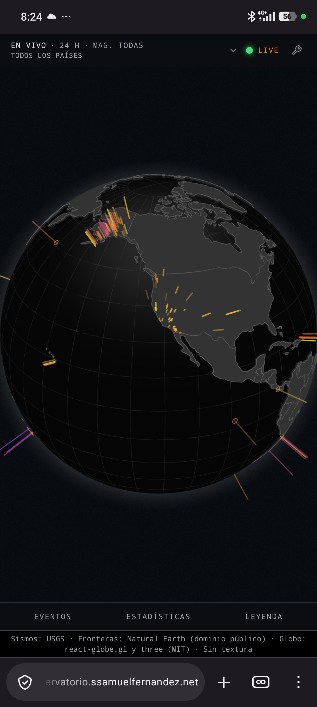

# H1: panel accesible desde otro dispositivo

**Estado: verificado a mano por el alumno (el panel público muestra datos reales); captura desde móvil con datos móviles pendiente.** Cubre H1, SC-006.

## Pasos

1. Con Compose, la API y `cloudflared` encendidos (README, «Procedimiento de activación»), confirma `curl https://observatorio-api.ssamuelfernandez.net/api/salud` con 200.
2. En un móvil, desactiva el wifi y usa datos móviles.
3. Abre `https://observatorio.ssamuelfernandez.net`.
4. Espera a que cargue y comprueba que se ven el mapa y los datos (sin error de red ni de CORS).
5. Haz una captura con la URL visible en la barra y la hora del dispositivo.

## Esperado

El panel carga desde datos móviles y muestra eventos reales (o el aviso de la última lectura si no hay).

## Registro

| Campo | Valor |
|---|---|
| Fecha y hora | (pendiente) |
| Dispositivo y red | (pendiente) |
| Resultado | (pendiente) |

**Captura (URL visible):** (pendiente del alumno)

## Captura recibida (2026-11-15)

**Estado: captura aportada por el alumno.** Archivo: [`H1_movil_datos_moviles.jpg`](H1_movil_datos_moviles.jpg).

| Campo | Valor |
|---|---|
| Fecha y hora | 2026-11-15; hora del móvil 8:24 (la captura no muestra la fecha) |
| Dispositivo y red | Móvil; indicador de red **4G+** (datos móviles) |
| Resultado | El panel carga en `…ervatorio.ssamuelfernandez.net` (URL visible, recortada por la izquierda), con globo con eventos, «EN VIVO · 24 H · MAG. TODAS · TODOS LOS PAÍSES» y estado **LIVE** en verde |

Límite: la URL aparece recortada en la barra (se ve `…ervatorio.ssamuelfernandez.net`) y no se ve ni el wifi apagado ni una ficha de evento. Lo aporta el alumno; el agente no la hizo.

