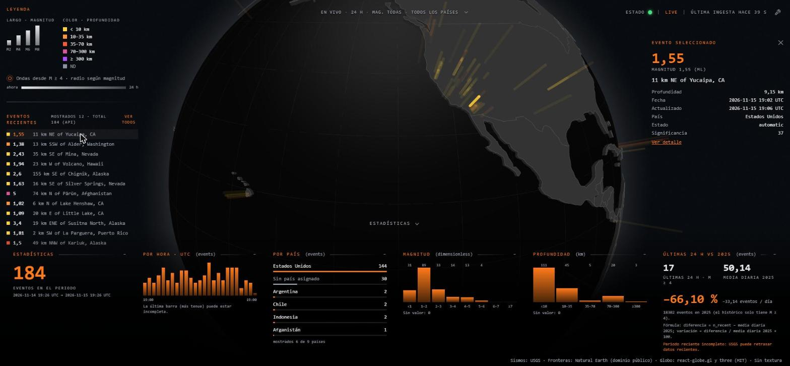

# Captura 1 (prueba 1, evento nuevo): hecha

**Estado: capturada** el 2026-11-15 a las ~19:26 UTC con el navegador integrado (Claude in Chrome), sobre el panel público en vivo. Es una captura de datos reales.

- **Archivo**: [`capturas/01_evento_nuevo.png`](capturas/01_evento_nuevo.png)
- **Fecha y hora de la captura (UTC)**: 2026-11-15 ~19:26:58 (marca de la propia pantalla: periodo 2026-11-14 19:26 → 2026-11-15 19:26 UTC).
- **URL / modo**: `https://observatorio.ssamuelfernandez.net/`, en vivo (datos reales de USGS; sin banner de «REPRODUCCIÓN» ni de «Datos sintéticos»).
- **event_id usado**: `ci41362543` (11 km NE of Yucaipa, CA), el primero de la lista de eventos recientes (`GET /api/eventos` lo devolvía el primero minutos antes, con `is_synthetic: false`).
- **Qué se ve**: la ficha abierta del evento (magnitud 1,55 ML, profundidad 9,15 km, fecha 2026-11-15 19:02 UTC, actualizado 19:06 UTC, país Estados Unidos), el evento resaltado en el mapa, y el análisis con el recuento total (184 eventos en el periodo) y la distribución por hora.
- **Límite**: la captura es del estado del panel en ese momento; el recuento sube con cada ingesta.

Evidencia principal de la prueba: [`01-evento-nuevo.md`](01-evento-nuevo.md).
