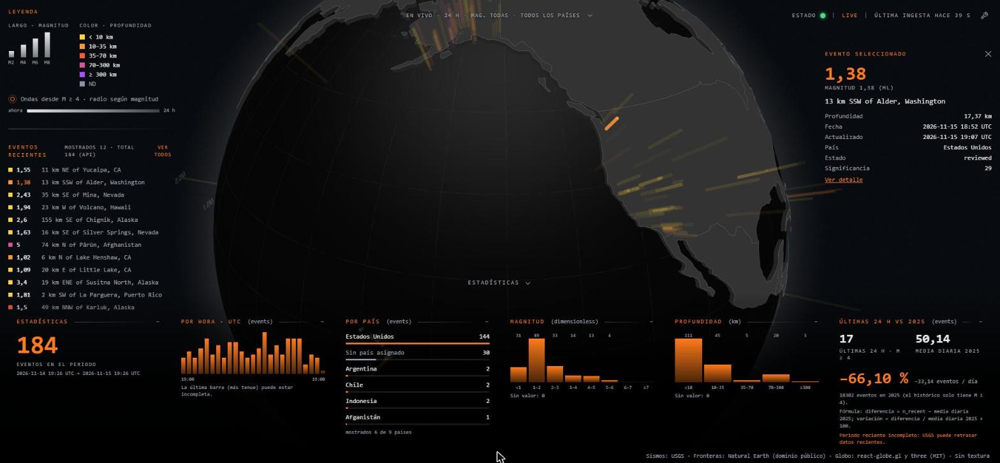

# Captura 3 (prueba 3, versión posterior): hecha con un caso real

**Estado: capturada** el 2026-11-15 a las ~19:26 UTC con el navegador integrado, sobre el panel público en vivo. Es un caso **real** (no sintético): el feed de USGS revisó el evento y el consumidor guardó las dos versiones. No se inyectó nada en `live`.

- **Archivo**: [`capturas/03_version_posterior.png`](capturas/03_version_posterior.png)
- **Fecha y hora de la captura (UTC)**: 2026-11-15 ~19:26:48.
- **URL / modo**: `https://observatorio.ssamuelfernandez.net/`, en vivo.
- **event_id usado**: `uw714139501` (13 km SSW of Alder, Washington).
- **Consulta de solo lectura** (`live.event_version`, comprobada antes de capturar):

  | updated_at (UTC) | mag | depth_km |
  |---|---|---|
  | 2026-11-15 18:55:07.7 | 1,5758 | 17,58 |
  | 2026-11-15 19:07:22.85 (posterior) | 1,38 | 17,37 |

  y `live.current_event` = 1,38, `updated_at` 19:07:22.85, país USA.
- **Qué se ve**: la ficha abierta con la versión **posterior** (magnitud 1,38, profundidad 17,37 km, actualizado 2026-11-15 19:07 UTC, estado `reviewed`) y el análisis (184 eventos, magnitud, país, hora). El historial con las dos versiones está en la consulta de arriba.
- **Límite**: la magnitud cae en el mismo tramo del histograma (1–2) en las dos versiones, así que el recuento por magnitud no cambia; el cambio visible es el del dato actual del evento. El caso con cambio de país y de hora y recuentos distintos sigue siendo sintético (`TempDatabase`; evidencia: SQL de T095, ver [`03-version-posterior.md`](03-version-posterior.md)).

