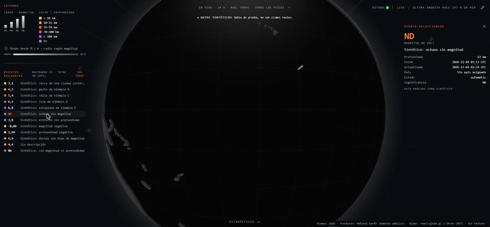

# Captura 5 (prueba 5, magnitud nula como ND): hecha en modo mock (sintético)

**Estado: capturada** el 2026-11-15 a las ~19:25 UTC con el navegador integrado, sobre un panel **local en modo mock** (datos **sintéticos**, etiquetados). No hay nulos reales y no se inyectó nada en `live` (C13).

- **Archivo**: [`capturas/05_magnitud_nula_nd.png`](capturas/05_magnitud_nula_nd.png)
- **Fecha y hora de la captura (UTC)**: 2026-11-15 ~19:25:43.
- **URL / modo**: `http://localhost:4301/?scenario=base`, **mock** (escenario `base`). Se sirvió con un Vite temporal en el puerto 4301 con una configuración fuera del repositorio; `frontend/public/config.json` no se tocó (`git diff` vacío) y el servidor se detuvo al acabar.
- **event_id usado**: `mock-base-006` («Sintético: océano sin magnitud»), el evento ND de `frontend/mock/base.json`.
- **Qué se ve**: la ficha abierta con magnitud **ND** (no `0`, no vacío), país «Sin país asignado», «Dato marcado como sintético»; el banner «DATOS SINTÉTICOS · Datos de prueba, no son sismos reales»; la leyenda con ND; y en la lista dos filas ND.
- **También cubre G2** (ficha abierta y evento ND). La ficha de un evento real abierta está en [`capturas/01_evento_nuevo.png`](capturas/01_evento_nuevo.png).

