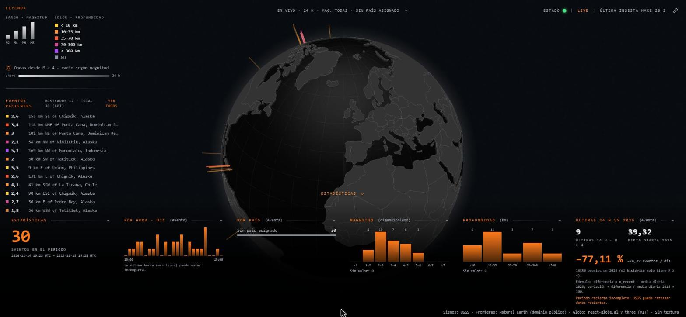

# Captura 7 (prueba 7, evento marítimo): hecha con datos reales

**Estado: capturada** el 2026-11-15 a las ~19:23 UTC con el navegador integrado, sobre el panel público en vivo. Datos reales de USGS.

- **Archivo**: [`capturas/07_evento_maritimo.png`](capturas/07_evento_maritimo.png)
- **Fecha y hora de la captura (UTC)**: 2026-11-15 ~19:23:45 (periodo 2026-11-14 19:23 → 2026-11-15 19:23 UTC).
- **URL / modo**: `https://observatorio.ssamuelfernandez.net/`, en vivo, con el filtro de país «Sin país asignado».
- **event_id usado**: no es un solo evento; son todos los eventos sin país del periodo. El primero de la lista es «155 km SE of Chignik, Alaska» (M 2,6).
- **Número de eventos mostrado**: **30** (lista, y «Por país: Sin país asignado 30» en las estadísticas; el total sin filtro era 184).
- **Qué se ve**: con el filtro activo, la lista y el mapa muestran eventos reales sin país, y el análisis (30 eventos, distribución por hora, magnitud, profundidad) los sigue contando.

