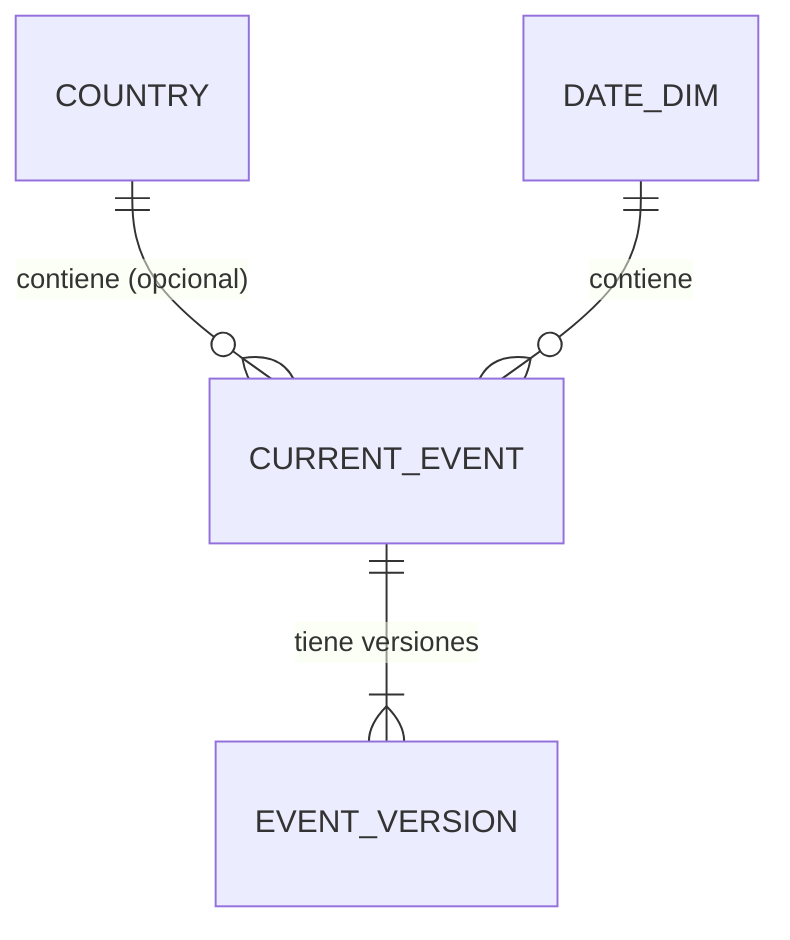

# Memoria — Observatorio de actividad sísmica

## 1. Objetivo, flujo de datos y alcance
## 2. Diccionario de datos

Fuente: feed `all_day.geojson` de USGS, según `docs/evidencias/f1/explore_usgs_salida.txt` (210 eventos). Los tiempos vienen en milisegundos Unix UTC y se convierten a UTC conservando el valor original. Los nulos no se rellenan con 0 y las magnitudes o profundidades negativas no se rechazan por serlo.

| Campo | Significado | Tipo / unidad | Si falta |
|---|---|---|---|
| `id` (raíz del Feature) | Identificador del evento (p. ej. `ci41570768`). Es único en la muestra (0 duplicados). | Texto | No faltó en la muestra (0 nulos). Un evento sin id es inválido y va a cuarentena. |
| `time` | Instante de origen del sismo. | Entero, milisegundos Unix (UTC) | No faltó (210/210). Un evento sin tiempo es inválido y va a cuarentena. |
| `updated` | Última actualización del evento. En la muestra nunca es anterior a `time`. | Entero, milisegundos Unix (UTC) | No faltó (210/210). Sirve para decidir qué versión es la más reciente. |
| `mag` | Magnitud del sismo. | Decimal, sin unidad (escala según `magType`) | No faltó en la muestra, pero el feed puede traerla nula: se guarda NULL, nunca 0. Hay un valor negativo (-0,06) y es válido. |
| `magType` | Tipo de escala de la magnitud. Valores vistos: `ml`, `md`, `mb`, `mww`, `mwr`. | Texto | No faltó (210/210); por confirmar su comportamiento si falta. |
| `place` | Descripción textual del lugar (p. ej. "3 km WSW of Anza, CA"). | Texto | No faltó (210/210). No se usa para obtener el país. |
| `type` | Tipo de evento. En la muestra todos son `earthquake`. | Texto | No faltó (210/210). Otros valores posibles: por confirmar. |
| `status` | Estado de revisión del evento. Valor visto: `automatic`; otros valores: por confirmar. | Texto | No faltó (210/210). |
| `coordinates[2]` (profundidad) | Profundidad del foco, tercera coordenada de la geometría. Hay 2 valores negativos (mínimo -0,18), válidos. | Decimal, kilómetros (unidad por confirmar con la documentación de USGS) | No faltó (0 nulos). Si falta se guarda NULL, nunca 0. |
## 3. Procedencia y registro de consultas
## 4. Calidad
## 5. Modelo conceptual, lógico y físico

> Borrador. Se completará con las mediciones de la sección 7 y con el resultado de la carga real cuando existan.

La base de datos se describe en tres niveles que representan **lo mismo**: el conceptual dice qué existe, el lógico lo organiza en tablas y claves, y el físico lo concreta en PostgreSQL 16. El DDL completo es [`sql/001_schema.sql`](../sql/001_schema.sql); su justificación, tabla por tabla, está en el contrato del esquema (`specs/001-contratos-y-modelo/contracts/db-schema.md`).

### 5.1 Modelo conceptual

El sistema guarda **terremotos**. Cada terremoto tiene un identificador de USGS y puede haber sido revisado varias veces: cada revisión es una **versión** y solo una es la **actual**. Un terremoto ocurre en un **día** y, si cae dentro de un polígono del catálogo, en un **país**; si no cae en ninguno queda «Sin país asignado» y no se deduce del texto del lugar. Aparte de los eventos, el sistema guarda lo que no se pudo aceptar (**cuarentena**), lo que se descartó a propósito por no ser un terremoto (**exclusión**) y el rastro de la **ingesta**: qué se publicó, qué consultas se hicieron al feed y qué respuestas originales se recibieron.

Hay dos conjuntos de eventos con la misma forma: el **modo en vivo** (que incluye el histórico de 2025) y la **reproducción**. Solo comparten el catálogo de países y las fechas; ningún evento pasa de uno a otro.

La cuarentena y las exclusiones se enlazan con los eventos solo por el identificador, sin clave foránea: un registro rechazado puede no corresponder a ningún evento válido.

### 5.2 Modelo lógico

Es un esquema de estrella pequeño, con el evento actual como tabla de hechos y el país y la fecha como dimensiones, más el historial de versiones y las tablas de calidad e ingesta.

| Tabla | Qué es una fila | Clave primaria | Relaciones |
|---|---|---|---|
| `current_event` | La versión actual de un terremoto | `event_id` | `country_id` → `country` (opcional); `date_id` → `date_dim` |
| `event_version` | Una versión observada de un evento | `(event_id, updated_ms)` | `event_id` → `current_event` |
| `country` | Un país del catálogo | `country_id` (código `ADM0_A3`) | — |
| `date_dim` | Un día UTC | `date_id` | — |
| `quarantine` | Un original rechazado y su motivo | `id`; único `(original_sha256, reason)` | — |
| `exclusion` | Un evento descartado de forma controlada | `id`; único `(event_id, updated_ms, kind)` | — |
| `ingest_state`, `ingest_run`, `raw_response` | Última versión publicada, una consulta al feed, una respuesta original | `event_id`, `id`, `id` | — |

Reglas que el modelo hace cumplir:

- **Versiones.** El estado actual solo se sustituye por una versión con `updated` estrictamente mayor. Toda versión recibida con un `updated` no visto se conserva en el historial, de modo que una revisión antigua que llega tarde no pisa a la posterior y un reenvío no duplica nada.
- **Tiempo.** Cada instante se guarda con su precisión completa (suficiente para agrupar por hora UTC) y también como el valor original de USGS en milisegundos.
- **Nulos.** Magnitud, profundidad y país admiten nulo, y el nulo nunca se sustituye por 0. Magnitudes y profundidades negativas son válidas.
- **Catálogo de países.** Cada evento se une con `country` por `country_id`, que se obtiene con un punto en polígono; así las agregaciones disponen del nombre en español, el continente y la subregión.

### 5.3 Modelo físico (PostgreSQL 16)

| Aspecto | Decisión |
|---|---|
| Esquemas | `public` (`country`, `date_dim`), `live` y `replay` (cuatro tablas cada uno, idénticas) y `ingest` (tres tablas, compartidas) |
| Instantes | `timestamptz` en UTC más un `bigint` con los milisegundos originales, con una restricción que obliga a que coincidan |
| Magnitud y profundidad | `numeric` que admite nulo, con límites de cordura (magnitud −10…15, profundidad −100…1000 km) que descartan `NaN` y valores imposibles sin rechazar negativos |
| Coordenadas | `double precision` con restricción de rango geográfico |
| Originales | `jsonb` para la versión original, la cuarentena y la respuesta cruda |
| Identificadores generados | `bigint GENERATED ALWAYS AS IDENTITY` |
| Datos sintéticos | `is_synthetic boolean NOT NULL DEFAULT false` en eventos, versiones, cuarentena y exclusiones |

Índices (cada uno responde a una consulta concreta; se conservarán solo si una medición con `EXPLAIN ANALYZE` los justifica, sección 7):

| Índice | Consulta que lo motiva |
|---|---|
| `ix_current_event_time (event_time DESC, event_id DESC)` | Listado de eventos por rango de tiempo con paginación estable |
| `ix_current_event_country_time (country_id, event_time DESC)` | Eventos de un país en un rango de tiempo |
| `ix_current_event_mag (mag)` | Filtro por magnitud mínima (candidato a medir) |
| `ix_quarantine_event_id` | Búsqueda de rechazos por evento |
| `ix_ingest_run_last_ok` (parcial) | Última consulta correcta al feed |
| `ix_raw_response_fetched_at`, `ix_raw_response_sha256` | Respuestas por fecha y detección de respuestas repetidas |

El aislamiento de la reproducción es estructural: `live` y `replay` son esquemas distintos con las mismas tablas, y los datos de reproducción nunca se escriben en `live`.

### 5.4 Equivalencia con la estructura orientativa del enunciado

| Enunciado | Proyecto | Qué representa una fila |
|---|---|---|
| `evento_actual` (hecho) | `current_event` | La versión más reciente de un terremoto |
| `evento_version` | `event_version` | Una versión observada, única por `(event_id, updated)` |
| `pais` | `country` | Una entidad del catálogo |
| `fecha` (`fecha_id`) | `date_dim` (`date_id`) | Un día UTC |
| `cuarentena` | `quarantine` | Un registro rechazado con su motivo |
| Estado de ingesta y calidad | `ingest_state`, `ingest_run`, `raw_response` y `exclusion` | Última versión publicada, consultas, respuestas originales y exclusiones |

Los identificadores del proyecto están en inglés; el enunciado usa nombres en español como estructura orientativa, no obligatoria.

### 5.5 Pruebas del esquema

El DDL se aplicó dos veces seguidas en PostgreSQL 16 sin errores, `live` y `replay` resultaron idénticos y un script de 18 pruebas comprobó las restricciones, las reglas de versiones, la cuarentena, el aislamiento y las consultas principales. Las salidas están en `docs/evidencias/contratos-y-modelo/`.

## 6. Análisis y conclusiones
## 7. Complejidad, mediciones y costes

### Mejoras propuestas

Añadir una capa de mares y océanos (polígonos de una segunda fuente por determinar, con licencia por comprobar y declarada como material reutilizado) para clasificar los eventos que hoy quedan en "Sin país asignado". Se justificará con el porcentaje real de eventos sin país cuando el histórico esté cargado (cifra pendiente).
## 8. Evidencias de las 11 pruebas
## 9. Reproducción histórica
## 10. Limitaciones

Los eventos en el mar quedan como "Sin país asignado"; el campo `place` de USGS se muestra como descripción, pero no se usa para asignar país.