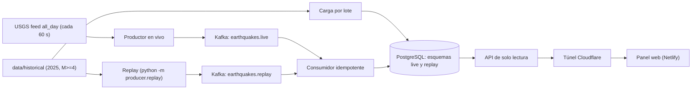
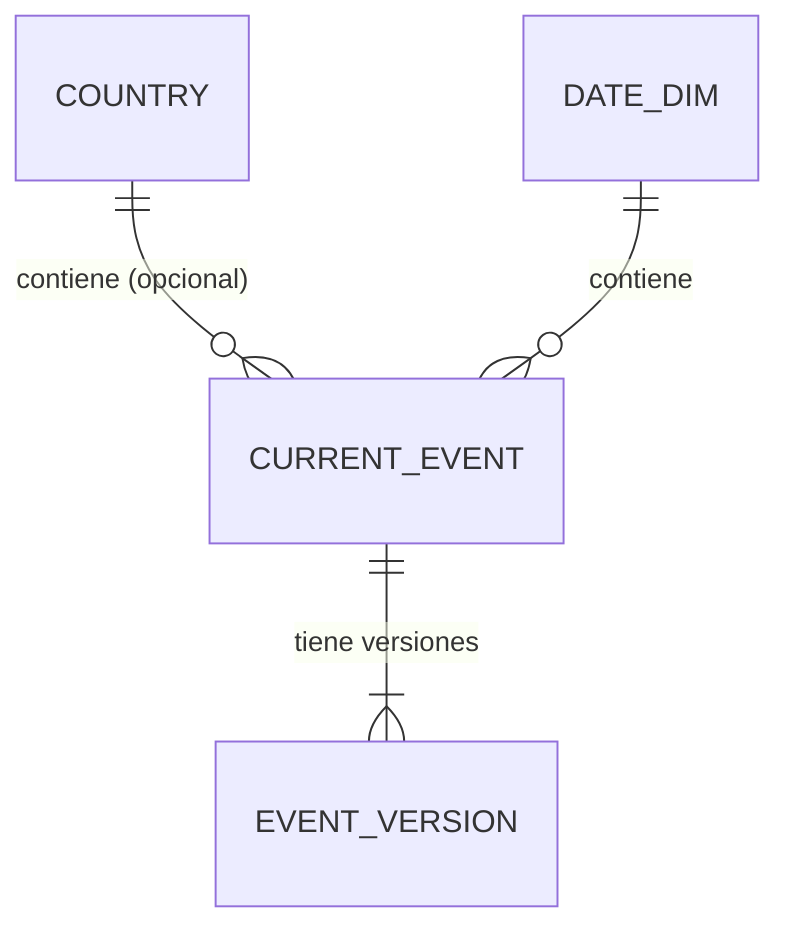

# Memoria — Observatorio de actividad sísmica

## 1. Objetivo, flujo de datos y alcance

**Qué se pretende responder.** ¿Qué actividad sísmica está ocurriendo ahora en el mundo y cómo se compara con 2025? El sistema consulta el feed de terremotos de USGS, guarda cada evento y cada revisión sin duplicados ni pérdidas, y lo muestra en un panel con mapa, tabla y gráficos que filtran de forma coherente. También permite reproducir una parte del histórico sin mezclarla con los datos reales.

**Flujo de datos** (cada flecha es un componente del repositorio; el detalle de ejecución está en el `README.md`):



El productor publica solo lo nuevo o revisado; el consumidor valida, asigna país por geometría, escribe en una transacción y confirma el offset después; la API calcula las estadísticas en SQL y el panel solo muestra lo que devuelve (el frontend no calcula estadísticas).

**Alcance y decisiones de alcance.**

- *Dentro:* feed en vivo de las últimas 24 h; histórico de 2025 (M≥4, mundial, `eventtype=earthquake`); país por geometría con el catálogo de Natural Earth 1:110 m (177 entidades); cuarentena con motivo; versiones de cada evento; API de consulta; panel con mapa, tabla y gráficos; replay aislado; mediciones de complejidad y costes.
- *Fuera, por decisión:* deducir el país del texto `place` (solo por geometría); detectar eventos que USGS elimine (§10, B11); automatizar la recuperación de un hueco de más de 24 h (§10, B12); comparación con periodos elegibles (la comparación es fija: últimas 24 h frente a la media diaria de 2025); ROI de los costes (§7.4).
- *Histórico:* es una instantánea a la fecha de extracción (2026-11-05), no incluye revisiones posteriores de USGS (B18, §3).
- *Datos sintéticos:* solo en pruebas, mock del panel y el bloque controlado del replay; van etiquetados (`is_synthetic`) y no entran en `live`.
- *Despliegue:* el panel está en Netlify y la API sale de un túnel que corre en el PC del alumno; solo hay datos públicos con ese equipo y `cloudflared` encendidos (§10).

## 2. Diccionario de datos

Fuente: feed `all_day.geojson` de USGS, según `docs/evidencias/f1/explore_usgs_salida.txt` (210 eventos). Los tiempos vienen en milisegundos Unix UTC y se convierten a UTC conservando el valor original. Los nulos no se rellenan con 0 y las magnitudes o profundidades negativas no se rechazan por serlo.

| Campo | Significado | Tipo / unidad | Si falta |
|---|---|---|---|
| `id` (raíz del Feature) | Identificador del evento (p. ej. `ci41570768`). Es único en la muestra (0 duplicados). | Texto | No faltó en la muestra (0 nulos). Un evento sin id es inválido y va a cuarentena. |
| `time` | Instante de origen del sismo. | Entero, milisegundos Unix (UTC) | No faltó (210/210). Un evento sin tiempo es inválido y va a cuarentena. |
| `updated` | Última actualización del evento. En la muestra nunca es anterior a `time`. | Entero, milisegundos Unix (UTC) | No faltó (210/210). Sirve para decidir qué versión es la más reciente. |
| `mag` | Magnitud del sismo. | Decimal, sin unidad (escala según `magType`) | No faltó en la muestra, pero el feed puede traerla nula: se guarda NULL, nunca 0. Hay un valor negativo (-0,06) y es válido. |
| `magType` | Tipo de escala de la magnitud. Valores vistos: `ml`, `md`, `mb`, `mww`, `mwr`. | Texto | No faltó (210/210). En el modelo `mag_type` admite nulo (el contrato dice que puede ser `null`); en los 19 385 eventos reales actuales de `live` (2026-11-16) hay 0 nulos. |
| `place` | Descripción textual del lugar (p. ej. "3 km WSW of Anza, CA"). | Texto | No faltó (210/210). No se usa para obtener el país. |
| `type` | Tipo de evento. En la muestra todos son `earthquake`. | Texto | No faltó (210/210). Un valor distinto de `earthquake` no entra en `current_event`: va a `live.exclusion` con el motivo `non_earthquake_type` (95 filas en `live.exclusion` el 2026-11-16). |
| `status` | Estado de revisión del evento. Valores vistos en `live` (2026-11-16, 19 385 eventos): `reviewed` (18 789) y `automatic` (596). | Texto | No faltó (210/210). El modelo lo admite nulo (0 nulos en `live`). |
| `coordinates[2]` (profundidad) | Profundidad del foco, tercera coordenada de la geometría. Hay 2 valores negativos (mínimo -0,18), válidos. | Decimal, kilómetros (columna `depth_km`; el contrato de la API fija `[longitud, latitud, profundidad_km]`) | No faltó (0 nulos). Si falta se guarda NULL, nunca 0. |
### 2.1 Respuesta del feed: opcionales, frecuencia, errores y latencia (B2)

Origen: `https://earthquake.usgs.gov/earthquakes/feed/v1.0/summary/all_day.geojson` (eventos de las últimas 24 horas). Las cifras proceden de una única exploración (`docs/evidencias/f1/explore_usgs_salida.txt`, generada con `scripts/explore_usgs.py`; respuesta del 2026-11-01 a las 14:33 UTC). Es una muestra de un momento: otras horas darán otros recuentos. Lo que no se midió se dice como tal.

**Estructura.** Un objeto GeoJSON con `type`, `metadata`, `features` y `bbox`. `metadata` trae `generated` (milisegundos Unix), `url`, `title`, `status` (200), `api` (2.8.2) y `count`. En la muestra `count` fue 210 y `features` tuvo 210 elementos; cada uno es un `Feature` con `id`, `properties` y `geometry`.

**Tipos y unidades** (complementa la tabla anterior).

| Campo | Tipo observado | Unidad o significado |
|---|---|---|
| `properties.time`, `properties.updated` | entero | Milisegundos desde 1970 en UTC |
| `properties.mag` | número (entero o decimal) | Magnitud, sin unidad; `magType` indica la escala (`ml`, `md`, `mb`, `mww`, `mwr` en la muestra) |
| `geometry.coordinates` | lista de 3 números | Longitud, latitud (grados) y profundidad (kilómetros, según la documentación de USGS) |
| `place`, `title`, `url`, `detail`, `net`, `code`, `ids`, `sources`, `types`, `status`, `type` | texto | Descriptivos |
| `nst`, `sig`, `tsunami`, `felt` | entero | Número de estaciones, significancia, indicador de tsunami, informes de percepción |
| `gap`, `dmin`, `rms`, `cdi`, `mmi` | número | Parámetros de calidad e intensidad de la localización |

**Opcionales y casos raros observados (de 210 eventos).**

- Presentes en los 210: `code`, `detail`, `dmin`, `gap`, `ids`, `mag`, `magType`, `net`, `nst`, `place`, `rms`, `sig`, `sources`, `status`, `time`, `title`, `tsunami`, `type`, `types`, `updated`, `url`.
- Opcionales (a menudo nulos): `alert` (4 de 210), `cdi` (14), `felt` (14), `mmi` (10). `tz` fue nulo en los 210.
- `mag` negativa: 1 caso (mínimo -0,06); no hubo `mag` nula en esta respuesta, aunque el contrato debe tolerarla.
- Profundidad negativa: 2 casos (mínimo -0,180000007152557).
- Tipo de evento: los 210 fueron `earthquake`; no apareció ningún otro tipo en esta muestra.
- Geometría: 210 `Point` con 3 coordenadas, ninguna nula ni fuera de rango. Identificadores sin nulos ni duplicados dentro de la respuesta.

**Frecuencia de actualización.** Cabeceras de la muestra: `Cache-Control: public, max-age=60`, `Last-Modified: Sun, 01 Nov 2026 14:33:01 GMT`, `Expires: Sun, 01 Nov 2026 14:34:01 GMT`, `Age: 23`. El feed se regenera aproximadamente cada 60 segundos, y por eso `POLL_SECONDS` vale 60 por defecto. `metadata.generated` cambia en cada regeneración aunque no haya eventos nuevos, así que el hash para detectar una respuesta distinta se calcula solo sobre `features`. Un evento ya publicado puede revisarse más tarde: `updated - time` fue, en minutos, de 0,6 (mínimo), 3,5 (mediana) y 1125,1 (máximo); por eso el productor republica solo si `updated` es mayor que el de la última versión publicada.

**Errores.** En la exploración la respuesta fue HTTP 200 y no se observó ningún error. Los fallos que el productor contempla (HTTP 429 y 5xx, tiempo de espera agotado, cuerpo que no es JSON) no están medidos contra USGS real: se prueban con un servidor simulado (`tests/support/mock_usgs.py`) y se tratan con espera creciente entre intentos (valores de configuración, no medidos: 2 s inicial, 60 s máxima, con aleatoriedad). El productor no lee la cabecera `Retry-After`.

**Latencia y tamaño.** En la muestra: 223 ms de latencia y 150 724 bytes de cuerpo. Es una sola medición; no se calcula una distribución. El tiempo de espera por operación de socket es `HTTP_TIMEOUT_SECONDS` (10 s por defecto).

### 2.2 Campos del modelo realmente usados

De los campos del feed, el sistema guarda estos en `current_event` (y, para la historia, en `event_version`); el resto del evento original queda íntegro en `event_version.original` (`jsonb`). Valores y nulos observados: `docs/evidencias/revision-final/procedencia-live.md` (2026-11-16, 19 385 eventos reales actuales de `live`; 0 nulos en `mag_type`, `status`, `url`, `sig` y `place`). Esquema completo: [`sql/001_schema.sql`](../sql/001_schema.sql).

| Campo del modelo | Viene de | Significado | Tipo / unidad | Si falta |
|---|---|---|---|---|
| `event_id` | `id` | Identificador USGS; clave de `current_event` | Texto | Cuarentena (`missing_id`) |
| `event_time`, `event_time_ms` | `properties.time` | Instante del sismo, en UTC y en milisegundos Unix originales (una restricción obliga a que coincidan) | `timestamptz` y `bigint` | Cuarentena (`missing_time`) |
| `updated_at`, `updated_ms` | `properties.updated` | Última revisión; decide qué versión es la actual | `timestamptz` y `bigint` | Cuarentena (`missing_updated`) |
| `mag`, `mag_type` | `mag`, `magType` | Magnitud (sin unidad) y su escala | `numeric` y texto, ambos nulables | NULL, nunca 0 |
| `depth_km` | `coordinates[2]` | Profundidad del foco | `numeric`, kilómetros, nulable | NULL, nunca 0 |
| `lon`, `lat` | `coordinates[0]`, `coordinates[1]` | Posición del epicentro | `double precision`, grados | Cuarentena (`invalid_geometry`) |
| `place`, `status`, `url`, `sig` | del mismo nombre | Descripción, estado de revisión, página del evento y significancia de USGS | texto, texto, texto y entero; todos nulables | NULL |
| `country_id` | calculado | `ADM0_A3` del polígono que contiene el punto; no se deduce de `place` | Texto de 3 letras, nulable | NULL = «Sin país asignado» |
| `date_id` | `event_time` | Día UTC del evento, enlace a `date_dim` | `date` | Siempre se calcula |
| `source` | del sistema | `usgs_feed`, `usgs_historical` o `replay_demo` | Texto | Obligatorio |
| `is_synthetic` | del sistema | `true` solo en datos sintéticos | Booleano | `false` por defecto |
| `ingested_at` | del sistema | Instante de ingesta (en el histórico, el de la carga por lote; ver §4.4) | `timestamptz` | Obligatorio |
| `replay_at` | del sistema | Instante de publicación del replay; nulo en `live` | `timestamptz`, nulable | NULL |
| `original`, `received_at`, `kafka_topic`, `kafka_partition`, `kafka_offset` (solo `event_version`) | del sistema | Versión original íntegra y su rastro en Kafka | `jsonb`, `timestamptz`, texto, entero, `bigint` | Según el origen (el histórico carga por lote, sin Kafka) |

## 3. Procedencia y registro de consultas

Toda consulta a una fuente externa deja un registro: las del feed en vivo, en la tabla `ingest.ingest_run` (URL, instante, estado HTTP, latencia, nº de eventos, hash y error); las del histórico, en [`data/historical/manifest.json`](../data/historical/manifest.json) (URL, intervalo, recuento de USGS, registros, fecha de extracción y sha256 de cada archivo). Las cifras del feed en vivo son del 2026-11-16 y salen de las consultas guardadas en [`docs/evidencias/revision-final/procedencia-live.md`](evidencias/revision-final/procedencia-live.md); crecen con el tiempo.

| Fuente | URL | Filtros | Registros | Fecha de extracción |
|---|---|---|---|---|
| Feed de USGS `all_day` (modo en vivo) | `https://earthquake.usgs.gov/earthquakes/feed/v1.0/summary/all_day.geojson` | Ninguno en la URL (el feed trae las últimas 24 h); el productor excluye lo que no es `earthquake` y lo registra en `live.exclusion` | 1 762 consultas, todas con HTTP 200 y sin error, del 2026-11-12 16:38 UTC al 2026-11-16 18:10 UTC; 774 respuestas originales guardadas; 1 083 eventos actuales con `source = usgs_feed`; 95 exclusiones `non_earthquake_type` | Continua, cada 60 s |
| Histórico 2025 de USGS | `https://earthquake.usgs.gov/fdsnws/event/1/query?format=geojson&starttime=<inicio>&endtime=<fin>&minmagnitude=4&eventtype=earthquake&orderby=time-asc` (una consulta por mes) | `minmagnitude=4`, `eventtype=earthquake`, mundial, año 2025 | 18 302 únicos (12 archivos mensuales; 0 duplicados descartados; coincide con el recuento anual de USGS, `usgs_count_year` 18 302); 18 302 cargados en `live.current_event` con `source = usgs_historical` | 2026-11-05, entre las 11:40:17 y las 11:40:33 UTC |
| Ensayo de hueco | La misma URL, intervalo 2025-12-30 a 2025-12-31 | Los mismos | 30 registros; es un ensayo del procedimiento (B12) y no cuenta en el total | 2026-11-05 11:47:12 UTC |
| Catálogo de países (Natural Earth, Admin 0, 1:110 m) | `https://raw.githubusercontent.com/nvkelso/natural-earth-vector/master/geojson/ne_110m_admin_0_countries.geojson` (según `docs/enunciado/FUENTES-Y-LICENCIAS.md`) | Ninguno; copia entregada con el enunciado y no modificada (`data/catalogo/paises.geojson`) | 177 entidades en `public.country`, cargadas al arrancar el consumidor | Incorporada al repositorio el 2026-11-01; la fecha de descarga no está registrada |
| Muestra de exploración del feed | La misma del feed `all_day` | Ninguno | 210 eventos (§2.1) | 2026-11-01 14:33 UTC |
| Replay (`earthquakes.replay`) | No consulta ninguna fuente externa: lee `data/historical/` | Zona `chile-norte`, los 20 primeros eventos por `(time, id)`, más 6 mensajes sintéticos | 26 mensajes publicados (§9) | 2026-11-12 |

**Histórico por meses** (registros por archivo, del manifiesto): enero 1 413, febrero 1 394, marzo 1 178, abril 1 316, mayo 1 228, junio 1 156, julio 2 684, agosto 2 222, septiembre 1 604, octubre 1 509, noviembre 1 321 y diciembre 1 277; suman 18 302. El manifiesto guarda también el sha256 de cada archivo, y la carga y el replay se detienen si falta alguno o ha cambiado.

**El histórico es una instantánea a la fecha de extracción (B18).** Los 18 302 eventos son lo que USGS devolvía el 2026-11-05 para 2025 con M≥4; no se reconcilian las revisiones que USGS haga después. Por eso un evento puede tener hoy en USGS una magnitud o una profundidad distintas de las guardadas aquí, y el sistema no lo detecta. Evidencia: `docs/evidencias/historico-2025/descarga_2025.log` y el manifiesto.

**Fuentes de las evidencias del productor.** Primer ciclo real (2026-11-04): `docs/evidencias/productor-live/ciclo1.log` (203 eventos recibidos, 12 excluidos, 191 publicados) y `docs/evidencias/productor-live/ciclo1_consultas.out` (3 consultas, las 3 con HTTP 200).

## 4. Calidad

### 4.1 Reglas de validación del consumidor

El consumidor valida cada mensaje de Kafka antes de tocar la base (`common/validation.py`, `common/validation_envelope.py`). Comprueba el tipo exacto (un `true` no es un número) y se detiene en el **primer** motivo que falla, en este orden. Los nulos se conservan como `NULL`: nunca se convierten en 0, y una magnitud o profundidad negativa es válida si está en rango.

| # | Motivo de cuarentena | Qué comprueba |
|---|---|---|
| 1 | `invalid_json` | Los bytes no son UTF-8 o JSON válido, o el valor es nulo (tombstone). |
| 2 | `invalid_envelope` | Faltan claves del sobre, `source` o `mode` fuera de los valores permitidos, `is_synthetic` no es booleano, o `ingested_at`/`replay_at` no son fechas UTC reales. |
| 3 | `mode_topic_mismatch` | El `mode` del mensaje no coincide con el del tema (por ejemplo, `replay` en `earthquakes.live`). |
| 4 | `replay_at_missing` | Un mensaje `replay` sin `replay_at`. |
| 5 | `missing_id` | Falta `id` del evento o está vacío. |
| 6 | `missing_time` | `properties.time` no es un entero. |
| 7 | `missing_updated` | `properties.updated` no es un entero. |
| 8 | `invalid_geometry` | La geometría no es un `Point` con al menos dos coordenadas. |
| 9 | `coordinates_out_of_range` | Longitud fuera de [-180, 180] o latitud fuera de [-90, 90] (o no finita). |
| 10 | `mag_out_of_range` | Magnitud fuera de [-10, 15]. |
| 11 | `depth_out_of_range` | Profundidad fuera de [-100, 1000] km. |
| 12 | `invalid_field_type` | `id`, `place`, `url`, `status` o `magType` no son texto; `sig` no es entero; `mag`, profundidad o coordenadas no son números. |
| 13 | `value_out_of_range` | `sig` fuera de `int32`, `time`/`updated` fuera del rango admitido por la base, o `id` de más de 512 caracteres. |
| 14 | `db_constraint_violation` | El evento no se puede guardar como `jsonb` (por ejemplo, anidamiento de más de 64 niveles). También se usa si la base rechaza el contenido con un error de integridad o de datos (SQLSTATE clase 23 o 22). |

### 4.2 Qué pasa con un mensaje inválido

- Va a la tabla `quarantine` con su motivo, el original, la referencia al mensaje (tema, partición y offset) y el SHA-256 de los bytes recibidos. No se escribe nada en las tablas de eventos.
- La clave de idempotencia es `(original_sha256, reason)`: el mismo original inválido por el mismo motivo no duplica fila.
- Una sola fila por mensaje, con el primer motivo según el orden anterior; el consumo no se detiene.
- `is_synthetic` se copia a la cuarentena solo si es un booleano exacto. Por eso las filas ilegibles (bytes no UTF-8 y tombstone) quedan en `false`.
- Los fallos de conexión con la base no son datos inválidos: se reintentan sin confirmar el offset y no producen cuarentena.

### 4.3 Reglas de escritura y verificación

- El offset se confirma solo después del commit en PostgreSQL; un corte entre ambos provoca una reentrega que se ignora (`ON CONFLICT (event_id, updated_ms) DO NOTHING`).
- Solo una versión con `updated` estrictamente mayor sustituye al estado actual; el historial conserva todas las versiones distintas.
- Evidencias: `docs/evidencias/consumidor-idempotente/` (pruebas 2, 3, 4, 6 y 8; 412 pruebas unitarias y 35 de integración en la feature, 2026-11-04; las suites completas del 2026-11-14 son 829 unitarias en verde con 3 fallos de entorno, y 232 de integración, §8).
### 4.4 Análisis de calidad sobre datos reales de `live` (C14)

Fecha: 2026-11-15. Base: el PostgreSQL del stack levantado, consultado en solo lectura (`default_transaction_read_only=on`). Esquema `live`, solo datos reales (`is_synthetic = false`). Las consultas completas, una por dimensión, están en `docs/evidencias/revision-final/calidad-live.md`, junto con el modo de reproducirlas; las cifras cambian con el tiempo porque el productor sigue ingiriendo, y las de aquí son las del 2026-11-15. Las incidencias de filas distintas no se suman: miden cosas distintas y pueden solaparse.

| Dimensión | Conjunto y denominador | Resultado |
|---|---|---|
| Completitud | Eventos actuales reales de `live.current_event`: 19 208 | `mag`, `mag_type`, `place` y profundidad al 100,00 % cada uno; `country_id` al 24,50 % |
| Unicidad | 19 208 eventos actuales y 19 509 versiones | 19 208 `event_id` distintos; 19 509 versiones distintas (0 duplicadas); 149 eventos con más de una versión |
| Validez | 19 208 eventos actuales reales | 0 magnitudes, profundidades o coordenadas fuera de rango o NaN; 13 magnitudes y 14 profundidades negativas (válidas); 0 reales en cuarentena |
| Consistencia | 19 208 eventos actuales reales | 0 estados actuales sin su versión; 0 que no sean la versión más reciente; 0 países fuera del catálogo; 0 con `updated` anterior a `time` |
| Actualidad | Agrupado por `source`: `usgs_feed` (906) y `usgs_historical` (18 302) | `usgs_feed`: mediana ocurrencia a `updated` 19,3 min, ocurrencia a ingesta 417,1 min (p95 1 289,5 min), máximo ocurrencia a `updated` 1,0 días. `usgs_historical`: mediana ocurrencia a `updated` 110 821,6 min, máximo 615,3 días; su `ingested_at` es el de la carga por lote |
| Exactitud | Agrupado por `source` (906 y 18 302) | `usgs_feed`: 152 de 906 sin país (16,8 %), magnitud de -0,6 a 5,8, profundidad de -3,42 a 587,447 km. `usgs_historical`: 14 350 de 18 302 sin país (78,4 %), magnitud de 4 a 8,8, profundidad de 0,5 a 669,556 km |

**Decisiones tomadas con estas cifras.**

1. Las 13 magnitudes y 14 profundidades negativas se conservan, porque USGS las publica y el rango del esquema las admite.
2. El 24,50 % de eventos con país (75,50 % «Sin país asignado») se declara como límite del catálogo de 110 m, no como fallo: los polígonos del catálogo son países (tierra, no aguas): un sismo en el mar queda sin país y se conserva, como pide el enunciado; es esperable que buena parte sea submarina, pero la consulta no lo mide. La proporción difiere entre histórico (solo M≥4: 78,4 % sin país) y feed (todas las magnitudes: 16,8 %); no se ha investigado la causa.
3. La actualidad se mide por separado para feed e histórico, porque el `ingested_at` del histórico es el momento de la carga, no un retraso real de ingesta.
4. El máximo de 615,3 días entre ocurrencia y `updated` del histórico muestra revisiones tardías de USGS que el sistema guarda como versiones sin duplicar eventos (149 eventos con más de una versión).

**Antes y después.** En los datos reales de `live` no hay nada que limpiar (0 duplicados, 0 fuera de rango, 0 estados desfasados, 0 reales en cuarentena), así que el «antes y después» se enseña con evidencia ya existente de las reglas aplicadas, sin recalcular nada:

- *Respuesta cruda frente a eventos limpios.* La respuesta cruda de USGS explorada (`docs/evidencias/f1/explore_usgs_salida.txt`) tenía 210 eventos, todos `earthquake`, con 1 magnitud negativa y 2 profundidades negativas; ninguno incumple las reglas de §4.1, así que todos serían aceptados tal cual, con los negativos conservados y sin rellenar nulos con 0. En `live` hay hoy 19 208 eventos reales y 0 reales en cuarentena.
- *Contadores del consumidor, caso controlado FAQ 12* (`docs/evidencias/consumidor-idempotente/faq12_antes_despues.out`, datos sintéticos etiquetados): antes, `live.current_event` 0 filas y `live.event_version` 0 filas; tras publicar 5 mensajes, 2 eventos actuales y 3 versiones, con los contadores `received` 5, `new_events` 2, `newer_versions_applied` 1 y `redeliveries_ignored` 2.
- *Cuarentena con motivo* (`prueba6_cuarentena.out`, sintético salvo las dos filas ilegibles): 6 mensajes inválidos producen 6 filas, con los motivos `coordinates_out_of_range`, `db_constraint_violation`, `invalid_json` (dos filas), `mode_topic_mismatch` y `value_out_of_range`; en `current_event` solo queda el mensaje válido y `event_version` tiene 1 fila.
- *Exclusiones* (`geografia_no_earthquake.out`, sintético): un evento con `properties.type` = `quarry blast` queda en `live.exclusion` (`non_earthquake_type`) y no entra en `current_event`.

**Límites.** El rango no es exactitud física: no hay una segunda fuente con la que contrastar magnitud, profundidad o posición. El país por geometría depende del catálogo simplificado. 906 eventos del feed son una ventana corta, así que sus medianas de actualidad son indicativas. `live.exclusion` no se analiza sobre datos reales en esta tabla: son eventos que nunca entran en `current_event`.

## 5. Modelo conceptual, lógico y físico

La base de datos se describe en tres niveles que representan **lo mismo**: el conceptual dice qué existe, el lógico lo organiza en tablas y claves, y el físico lo concreta en PostgreSQL 16. El DDL completo es [`sql/001_schema.sql`](../sql/001_schema.sql); su justificación, tabla por tabla, está en el contrato del esquema (`specs/001-contratos-y-modelo/contracts/db-schema.md`).

### 5.1 Modelo conceptual

El sistema guarda **terremotos**. Cada terremoto tiene un identificador de USGS y puede haber sido revisado varias veces: cada revisión es una **versión** y solo una es la **actual**. Un terremoto ocurre en un **día** y, si cae dentro de un polígono del catálogo, en un **país**; si no cae en ninguno queda «Sin país asignado» y no se deduce del texto del lugar. Aparte de los eventos, el sistema guarda lo que no se pudo aceptar (**cuarentena**), lo que se descartó a propósito por no ser un terremoto (**exclusión**) y el rastro de la **ingesta**: qué se publicó, qué consultas se hicieron al feed y qué respuestas originales se recibieron.

Hay dos conjuntos de eventos con la misma forma: el **modo en vivo** (que incluye el histórico de 2025) y la **reproducción**. Solo comparten el catálogo de países y las fechas; ningún evento pasa de uno a otro.



La cuarentena y las exclusiones se enlazan con los eventos solo por el identificador, sin clave foránea: un registro rechazado puede no corresponder a ningún evento válido.

### 5.2 Modelo lógico

Es un esquema de estrella pequeño, con el evento actual como tabla de hechos y el país y la fecha como dimensiones, más el historial de versiones y las tablas de calidad e ingesta.

| Tabla | Qué es una fila | Clave primaria | Relaciones |
|---|---|---|---|
| `current_event` | La versión actual de un terremoto | `event_id` | `country_id` → `country` (opcional); `date_id` → `date_dim` |
| `event_version` | Una versión observada de un evento | `(event_id, updated_ms)` | `event_id` → `current_event` |
| `country` | Un país del catálogo | `country_id` (código `ADM0_A3`) | — |
| `date_dim` | Un día UTC | `date_id` | — |
| `quarantine` | Un original rechazado y su motivo | `id`; único `(original_sha256, reason)` | — |
| `exclusion` | Un evento descartado de forma controlada | `id`; único `(event_id, updated_ms, kind)` | — |
| `ingest_state`, `ingest_run`, `raw_response` | Última versión publicada, una consulta al feed, una respuesta original | `event_id`, `id`, `id` | — |

Reglas que el modelo hace cumplir:

- **Versiones.** El estado actual solo se sustituye por una versión con `updated` estrictamente mayor. Toda versión recibida con un `updated` no visto se conserva en el historial, de modo que una revisión antigua que llega tarde no pisa a la posterior y un reenvío no duplica nada.
- **Tiempo.** Cada instante se guarda con su precisión completa (suficiente para agrupar por hora UTC) y también como el valor original de USGS en milisegundos.
- **Nulos.** Magnitud, profundidad y país admiten nulo, y el nulo nunca se sustituye por 0. Magnitudes y profundidades negativas son válidas.
- **Catálogo de países.** Cada evento se une con `country` por `country_id`, que se obtiene con un punto en polígono; así las agregaciones disponen del nombre en español, el continente y la subregión.

### 5.3 Modelo físico (PostgreSQL 16)

| Aspecto | Decisión |
|---|---|
| Esquemas | `public` (`country`, `date_dim`), `live` y `replay` (cuatro tablas cada uno, idénticas) y `ingest` (tres tablas, compartidas) |
| Instantes | `timestamptz` en UTC más un `bigint` con los milisegundos originales, con una restricción que obliga a que coincidan |
| Magnitud y profundidad | `numeric` que admite nulo, con límites de cordura (magnitud −10…15, profundidad −100…1000 km) que descartan `NaN` y valores imposibles sin rechazar negativos |
| Coordenadas | `double precision` con restricción de rango geográfico |
| Originales | `jsonb` para la versión original, la cuarentena y la respuesta cruda |
| Identificadores generados | `bigint GENERATED ALWAYS AS IDENTITY` |
| Datos sintéticos | `is_synthetic boolean NOT NULL DEFAULT false` en eventos, versiones, cuarentena y exclusiones |

Índices (cada uno responde a una consulta concreta; se conservarán solo si una medición con `EXPLAIN ANALYZE` los justifica, sección 7):

| Índice | Consulta que lo motiva |
|---|---|
| `ix_current_event_time (event_time DESC, event_id DESC)` | Listado de eventos por rango de tiempo con paginación estable |
| `ix_current_event_country_time (country_id, event_time DESC)` | Eventos de un país en un rango de tiempo |
| `ix_current_event_mag (mag)` | Filtro por magnitud mínima (candidato a medir) |
| `ix_quarantine_event_id` | Búsqueda de rechazos por evento |
| `ix_ingest_run_last_ok` (parcial) | Última consulta correcta al feed |
| `ix_raw_response_fetched_at`, `ix_raw_response_sha256` | Respuestas por fecha y detección de respuestas repetidas |

El aislamiento de la reproducción es estructural: `live` y `replay` son esquemas distintos con las mismas tablas, y los datos de reproducción nunca se escriben en `live`.

### 5.4 Equivalencia con la estructura orientativa del enunciado

| Enunciado | Proyecto | Qué representa una fila |
|---|---|---|
| `evento_actual` (hecho) | `current_event` | La versión más reciente de un terremoto |
| `evento_version` | `event_version` | Una versión observada, única por `(event_id, updated)` |
| `pais` | `country` | Una entidad del catálogo |
| `fecha` (`fecha_id`) | `date_dim` (`date_id`) | Un día UTC |
| `cuarentena` | `quarantine` | Un registro rechazado con su motivo |
| Estado de ingesta y calidad | `ingest_state`, `ingest_run`, `raw_response` y `exclusion` | Última versión publicada, consultas, respuestas originales y exclusiones |

Los identificadores del proyecto están en inglés; el enunciado usa nombres en español como estructura orientativa, no obligatoria.

### 5.5 Pruebas del esquema

El DDL se aplicó dos veces seguidas en PostgreSQL 16 sin errores, `live` y `replay` resultaron idénticos y un script de 18 pruebas comprobó las restricciones, las reglas de versiones, la cuarentena, el aislamiento y las consultas principales. Las salidas están en `docs/evidencias/contratos-y-modelo/`.

## 6. Análisis y conclusiones

Periodo: 2025-01-01 a 2026-01-01 (UTC). Conjunto: los 18 302 eventos del histórico en `live.current_event` (M≥4, mundial, `is_synthetic = false`). Las cifras proceden de SQL de solo lectura y coinciden con las de la API (`GET /api/estadisticas?start=2025-01-01&end=2026-01-01`: `total` 18 302); el panel no calcula nada. Consultas y resultados completos, con el modo de reproducirlos: [`docs/evidencias/revision-final/conclusiones-analisis.md`](evidencias/revision-final/conclusiones-analisis.md) (ejecutadas el 2026-11-16).

**Conclusión 1: julio y agosto concentran el 26,8 % de los eventos del año por una única secuencia sísmica.** Hubo 2 684 eventos en julio y 2 222 en agosto, frente a 1 156 a 1 604 en los demás meses. Casi todo el exceso está en una caja geográfica de Kamchatka (latitud 48 a 58, longitud 155 a 165): 1 361 y 1 239 eventos en esos dos meses, frente a 7 a 16 al mes de enero a junio. El mayor evento del año, `us6000qw60` (M 8,8, 2025-07-29 23:24 UTC), es de esa zona. Filtros: ninguno de magnitud ni de país; la caja se usó solo para esta comprobación. Denominador: 18 302 (por mes, el recuento del mes). Límite: la caja es un filtro mío, no un país, y no se ha contrastado con otra fuente. En la API: `start=2025-07-01&end=2025-08-01` devuelve `total` 2 684.

**Conclusión 2: el 78,4 % de los eventos queda «Sin país asignado», así que un ranking por país describe solo una minoría.** 14 350 de 18 302 no caen en ningún polígono del catálogo de 110 m. Esos polígonos son los países, es decir, tierra y no aguas: un sismo en el mar queda sin país, y el enunciado pide conservarlo y explicar que puede estar en el mar. Cabe esperar que buena parte de la sismicidad M≥4 sea submarina, pero esta consulta no lo mide: no se ha desglosado qué parte de los 14 350 es mar abierto y qué parte es simplificación del catálogo en costas y territorios pequeños (`docs/borradores/geografia-pais.md`). Con país, los más frecuentes son China (354; 1,9 %), Chile (348; 1,9 %), Indonesia (306; 1,7 %), Etiopía (265; 1,4 %) y Argentina (236; 1,3 %). Filtros: ninguno; en la API, `country_id=none` devuelve `total` 14 350. Denominador: 18 302. Se declara como límite del catálogo (polígonos de tierra, 110 m) y no como fallo (§4.4); no se afirma una causa concreta.

**Conclusión 3: los eventos son sobre todo pequeños y someros, y la distribución es muy asimétrica.** El 88,4 % tiene magnitud entre 4,0 y 4,9 (16 173 de 18 302); solo el 0,79 % llega a M≥6 (145: 129 entre 6 y 6,9 y 16 de 7 o más). El 74,8 % está a menos de 70 km (13 689) con mediana de 20,9 km, y el 6,0 % a 300 km o más (1 102). Filtros: ninguno; en la API, `min_mag=6` devuelve `total` 145 y el histograma de magnitud da 16 173, 1 984, 129 y 16 por tramos. Denominador: 18 302. Una media de magnitud ocultaría los pocos eventos grandes; conviene mirar los tramos.

**Qué no se concluye.** La comparación de las últimas 24 h con la media diaria de 2025 (en la consulta del 2026-11-16, 16 eventos recientes frente a 50,14 por día) llega marcada por la API como `recent_incomplete: true` y no se ha investigado la causa, así que no se usa como conclusión (§10).

**Captura.** No hay una captura nueva del panel con estos filtros, porque desde esta sesión no se puede guardar en el repositorio una imagen del navegador. Hay una captura del panel público del 2026-11-12 (`docs/evidencias/despliegue-tunel/2026-11-12_panel-publico.png`) y la coherencia entre mapa, tabla y gráficos está comprobada en `docs/evidencias/api/coherencia_real.txt`; los filtros se mostrarán en el vídeo.

## 7. Complejidad, mediciones y costes

Cifras copiadas de [`docs/evidencias/mediciones/`](evidencias/mediciones/README.md) (cada una con su id de medición en `resultados.json`). Los datos de `bench` son **SINTÉTICOS** (esquema temporal `bench`, semilla 20251113, eliminado al terminar, sin ninguna fila fuera de él: `aislamiento.md`); los datos reales (REAL) solo se leyeron. Tiempos en ms (mediana de hasta 15 repeticiones), medidos en la VM de Docker Desktop (Windows, WSL2) con 24 CPU y 15,17 GiB (`equipo.md`). Procedimiento: [`procedimiento.md`](evidencias/mediciones/procedimiento.md). Tamaños: 1.000, 10.000 y 100.000 filas; 102 mediciones.

### 7.1 Operaciones, teoría y observado (K1, K2, K3)

| Operación | Estrategias | Coste medio / peor caso (teoría) | Observado a 100.000 filas (SINTÉTICO) |
|---|---|---|---|
| a. Búsqueda de versiones por id | lista, `dict`, PostgreSQL sin índice y con índice | lista O(n) / O(n); `dict` O(1) / O(n) teórico; `Seq Scan` O(n); B-tree O(log n) | id ausente: lista 2,058552 ms; `dict` 0,000062 ms; sin índice 4,799034 ms; con índice 0,146670 ms. Construir el `dict`: 6,512775 ms y 5.632,09 KiB de pico |
| b. Integración geográfica (punto en 177 polígonos) | bucle ingenuo y `STRtree` | lineal en puntos; el árbol reduce los polígonos candidatos | puntos mezclados: bucle 1.919,619815 ms; `STRtree` 610,28769 ms; 0 de 100.000 con resultado distinto entre métodos |
| c. Agregación por ventanas (Q2, Q3, Q4 de `db-schema.md` §4) | sin índice y con índice | `Seq Scan` O(n) / O(n); con índice depende de las filas devueltas | Q2 un mes: 5,358898 → 0,182825 ms; Q4 un día: 3,526351 → 0,375212 ms; Q4 toda la tabla: 17,246617 vs 17,316232 ms (el índice no ayuda) |

En el caso **medio** el id está en el medio, los puntos son mezclados y la ventana es selectiva; en el **peor**, el id no existe, los puntos caen en el océano (recorren los 177 polígonos) y la ventana abarca casi toda la tabla. Comparación completa de teoría frente a observado: [`teoria_vs_observado.md`](evidencias/mediciones/teoria_vs_observado.md); tablas de las 102 mediciones: [`tablas.md`](evidencias/mediciones/tablas.md).

### 7.2 Índices justificados con medición (E6)

| Índice | Veredicto (SINTÉTICO) |
|---|---|
| `ix_current_event_country_time` | Justificado en los 6 casos de Q2 |
| `ix_current_event_time` | Justificado para un día a 10.000 y 100.000 filas; no concluyente a 1.000; no justificado con la ventana de toda la tabla |
| `ix_current_event_mag` | Depende del umbral y del tamaño: con `mag >= 4` (selectividad 0,9458) solo mejora de 5,956245 a 4,00266 ms a 100.000 filas; en la base real tiene 9 lecturas y 560 KiB. No queda demostrado conservarlo ni descartarlo |

Son propuestas: no se ha modificado el DDL. Detalle en [`indices.md`](evidencias/mediciones/indices.md).

### 7.3 Qué pasaría con 100 millones de registros (K5)

Razonamiento SUPUESTO a partir de lo medido hasta 100.000 filas; no se midió 10^8 ([`escalado.md`](evidencias/mediciones/escalado.md)):

- **Almacenamiento:** 363,2 B por fila de `bench` con índices darían 33,8 GiB; `live.event_version` (1.090,3 B por fila real) daría 101,5 GiB.
- **CPU:** la integración geográfica con `STRtree` serían 10,2 min (bucle ingenuo, 32 min). Sin índice, buscar por id costaría del orden de 4.799 ms frente a 0,147 ms con índice.
- **Escrituras:** una transacción por mensaje serían 4,0 h solo de ida y vuelta; con lotes de 1.000, 14,5 s.
- **Paralelismo:** con 12 consumidores la integración geográfica bajaría a 51 s; hacen falta al menos tantas particiones de Kafka como consumidores (cambio de contrato, decisión del alumno).
- **Particionado por `event_time`:** una ventana de un día leería unas 54 veces menos filas; obliga a cambiar la clave primaria.

### 7.4 Costes (K6)

Cada cifra lleva su origen (MEDIDO, SUPUESTO o ESTIMADO) y su naturaleza (en efectivo o imputada: el equipo y el tiempo propio no desembolsan dinero, pero tienen coste). Mes de 30 días, 0,169 EUR/kWh, 100 W. Fórmulas y entradas: [`costes.md`](evidencias/mediciones/costes.md).

| Concepto | Naturaleza | A: 12 h/día (EUR/mes) | B: 24/7 (EUR/mes) |
|---|---|---|---|
| Hardware (1.100 EUR / 48 meses, fracción de uso 1) | imputado | 22,92 | 22,92 |
| Electricidad | efectivo | 6,08 | 12,17 |
| Almacenamiento (0,0439215 GiB MEDIDO) | imputado; efectivo 0 | 0,0006 | 0,0006 |
| Transferencia (109.996 B por petición MEDIDO; 5 a 10 visitas/mes SUPUESTO) | efectivo 0 | 0 | 0 |
| Mantenimiento (2 h/mes x 15 EUR/h) | imputado | 30,00 | 30,00 |
| Dominio (22 EUR/año) | efectivo | 1,83 | 1,83 |
| **Total imputado** | | **≈ 60,8** | **≈ 66,9** |
| **Total en efectivo** | | **≈ 7,9** | **≈ 14,0** |

Desarrollo: 1.080 EUR una sola vez (72 h x 15 EUR/h; rango 810 a 1.350 EUR). Una cuota gratuita (Netlify, Cloudflare Tunnel) no equivale a coste cero: superar su límite puede generar un cobro. No se calcula ROI ni se atribuye un beneficio económico al observatorio.

### 7.5 Propuestas de escalado ligadas a hallazgos (K7)

Las 8 propuestas, cada una con su problema medido, la mejora y la medición que la confirmaría, están en [`escalado.md`](evidencias/mediciones/escalado.md). Entre ellas: mantener la clave primaria para toda búsqueda por id (32,7 veces más rápida que sin índice); no cargar todos los ids en un `dict` en el consumidor; repartir la integración geográfica entre consumidores; escribir por lotes; comprimir la respuesta de `/api/eventos` (el 97,4 % de los bytes de una visita) y definir una retención para `ingest.raw_response` (el 18,8 % de la base). Las que tocan contrato o DDL son decisión del alumno.

### 7.6 Limitaciones de la medición

- Medido en la VM de Docker Desktop (WSL2), no en el anfitrión directamente; el stack siguió en marcha durante las mediciones. Los tiempos absolutos no se trasladan a otro equipo: sirve la comparación entre estrategias dentro de la misma corrida.
- La memoria con `tracemalloc` solo cuenta lo que reserva Python y solo se midió al construir el `dict` y en la integración geográfica.
- Con 1.000 filas domina la ida y vuelta al servidor (ruido): ahí el `Seq Scan` no se distingue del índice. Con tres tamaños solo se puede decir que la tendencia es compatible con la teoría.
- Valor atípico sin explicar: `server_ms` de `search.pg_seq.100000.first` (7,057 ms).
- Costes: casi todo es SUPUESTO; el consumo eléctrico (100 W) no se midió, y la cuota de Netlify es plan gratuito, según indica el alumno (no se ha comprobado en el panel de Netlify).
- Aún no se ha repetido el procedimiento desde un clon limpio.

### Mejoras propuestas

Añadir una capa de mares y océanos (polígonos de una segunda fuente por determinar, con licencia por comprobar y declarada como material reutilizado) para clasificar los eventos que hoy quedan en "Sin país asignado". Se justifica con el porcentaje real, ya con el histórico cargado: 14 350 de 18 302 eventos de 2025 (78,4 %) quedan sin país (§6, conclusión 2; consulta en `docs/evidencias/revision-final/conclusiones-analisis.md`).
## 8. Evidencias de las 11 pruebas

Cada fila enlaza su ficha en `docs/evidencias/pruebas/` (procedimiento, esperado, observado, evidencia, cómo repetir y estado); el resumen está en [`docs/evidencias/pruebas/README.md`](evidencias/pruebas/README.md). Las pruebas con datos sintéticos están etiquetadas como tales. Pruebas del 2026-11-14: 0 fallos en las ejecutadas por archivo; la suite completa dio 829 unitarias en verde y 3 fallos de entorno ajenos a las pruebas (`tests/scripts/test_netlify_config.py`, porque el servicio `tests` no monta `netlify.toml` ni `frontend/.nvmrc`), y 232 de integración en verde.

| Prueba | Esperado | Observado | Ficha |
|---|---|---|---|
| 1 Evento nuevo | 1 fila actual, visible en la API y en las estadísticas | Real (2026-11-04): `current_event` de 192 a 193 hasta PostgreSQL. Sintética: prueba de API en verde. Captura del panel con un evento real (`ci41362543`, 2026-11-15) | [01](evidencias/pruebas/01-evento-nuevo.md) |
| 2 Reenvío | Recuentos idénticos tras reenviar | 100 reenvíos: 2 actuales, 3 versiones y 0 en cuarentena, antes y después (sintética) | [02](evidencias/pruebas/02-reenvio.md) |
| 3 Versión posterior | El actual y los agregados cambian; el historial conserva ambas | `event_version` de 3 a 4 con 2 actuales (sintética). Captura real: `uw714139501`, 2 versiones (magnitud 1,5758 a 1,38) | [03](evidencias/pruebas/03-version-posterior.md) |
| 4 Versión tardía | Actual y API sin cambios; la tardía queda en el historial | API idéntica antes y después; tardía en `event_version` (sintética) | [04](evidencias/pruebas/04-version-tardia.md) |
| 5 Magnitud nula | NULL en SQL, `null` en la API y ND en el panel | `mag` NULL y 0 filas con `mag = 0`; no hay nulos reales y el ND de la captura sale del mock sintético | [05](evidencias/pruebas/05-magnitud-nula.md) |
| 6 Coordenadas inválidas | Cuarentena con motivo y referencia; sin fila actual | Latitud 145 a `coordinates_out_of_range` (offset 7, sha256 guardado) (sintética) | [06](evidencias/pruebas/06-coordenadas-invalidas.md) |
| 7 Evento marítimo | `country_id` NULL, sin cuarentena, contado en el total y por hora | Total 3 = 2 con país + 1 sin país (sintética); en el feed real de un día, 28 de 181 sin país; captura real con 30 eventos sin país (2026-11-15) | [07](evidencias/pruebas/07-evento-maritimo.md) |
| 8 Reinicio del consumidor | Misma base con y sin corte | Corte en el offset 2 (código 137), SQL idéntico: 2 actuales, 3 versiones, 0 en cuarentena | [08](evidencias/pruebas/08-reinicio-consumidor.md) |
| 9 Cierre del túnel | Aviso «Datos antiguos» con la hora de la última lectura y los datos visibles | Con el túnel real cerrado, la captura [`09_cierre_tunel_sin_respuesta.png`](evidencias/pruebas/capturas/09_cierre_tunel_sin_respuesta.png) muestra «SIN RESPUESTA DE LA API», el aviso «SIN DATOS: No se pudo conectar con la API…» y «EVENTOS RECIENTES: SIN DATOS»: el fallo se muestra y no se presenta como 0 eventos. Es un panel cargado ya con el túnel cerrado: **no** muestra «Datos antiguos» ni la última lectura conservada. El código sí lo implementa (`StatusBanners.tsx:82-89`, `useObservatory.ts:49-51`). La demostración completa se hará en vivo en el vídeo | [09](evidencias/pruebas/09-cierre-tunel.md) |
| 10 Reapertura del túnel | El panel se recupera sin recargar | Sin captura: solo revisión de código (`refetchInterval` sigue activo tras el error). La demostración en vivo irá en el vídeo | [10](evidencias/pruebas/10-reapertura-tunel.md) |
| 11 Reproducción histórica | 26 mensajes a 22 / 24 / 0 en `replay`; `live` intacto | `replay` 22 / 24 / 0 (2026-11-12); `live` 211 / 211 / 0 con la misma huella `md5`; 8 pruebas en verde el 2026-11-14 | [11](evidencias/pruebas/11-reproduccion-historica.md) |

Para las pruebas 9 y 10 se aceptan como suficientes las capturas existentes más la demostración en vivo del vídeo. Con los ajustes actuales del panel (`refreshSeconds` 60 y `timeoutMs` 15 000), el aviso y la recuperación pueden tardar hasta unos 75 s; con la pestaña oculta el refresco puede detenerse y volver a la pestaña no fuerza un refresco (`docs/evidencias/pruebas/09-10_revision_codigo.txt`).

## 9. Reproducción histórica

Reproduce por Kafka una selección de eventos reales de 2025 para tener actividad que mostrar sin esperar a un terremoto, aislada de `live` y etiquetada «REPRODUCCIÓN». Detalle: sección «Replay» del `README.md` y [`docs/borradores/replay.md`](borradores/replay.md); evidencias: [`docs/evidencias/replay/`](evidencias/replay/README.md).

**Selección.** Los 20 primeros eventos (por `time`, desempate por `id`) de la zona `chile-norte` (latitud −27 a −18, longitud −72 a −68,5), del 2025-01-01 08:08 UTC al 2025-01-29 03:44 UTC, leídos de `data/historical/` tras verificar el sha256 de cada archivo. Hay 267 eventos en la zona y un país reconocible (18 en Chile, 1 en Bolivia y 1 sin país). La otra zona disponible, `japon-honshu`, se descartó porque 9 de sus 20 primeros caen en el mar. El orden determinista hace el replay repetible. A los 20 se añade un **bloque controlado** de 6 mensajes sobre dos eventos sintéticos (`synthetic-replay-e1` y `synthetic-replay-e2`, `is_synthetic = true`): reenvíos, una versión posterior y una antigua tardía; se fabrican para no marcar como sintético un dato real.

**Comando.**

```bash
docker compose run --rm producer python -m producer.replay --interval 2 --zone chile-norte --count 20
```

**Velocidad.** `--interval` son los segundos entre mensajes (2 por defecto): un intervalo fijo, no una compresión proporcional del tiempo original. Dura unos 52 s (51 s medidos). El tiempo original (`time`, `updated`) no se toca; se añade `replay_at`, el instante de publicación.

**Aislamiento, en tres capas.** (1) El replay solo publica en `earthquakes.replay`. (2) El consumidor guarda lo de ese topic únicamente en el esquema `replay`. (3) Comprueba que el campo `mode` del mensaje coincide con el topic y, si no, lo manda a cuarentena con `mode_topic_mismatch`. Se comprobó con el productor live parado: las tablas de `live` quedaron idénticas antes y después (211 / 211 / 0 y la misma huella `md5`).

**Banner.** Con «Reproducción» elegido, el panel muestra el banner «REPRODUCCIÓN» y los 22 eventos de 2025 (`metadata.mode = "replay"`); «En vivo» los oculta (`docs/evidencias/replay/T056_panel.md`, `docs/evidencias/replay/T056_reproduccion.png`, `docs/evidencias/replay/T056_en_vivo.png`).

**Resultados** (demo completa con contenedores, 2026-11-12):

| Medida | Esperado | Observado |
|---|---|---|
| Mensajes publicados | 26 | 26 (20 reales y 6 del bloque) |
| `replay.current_event` / `replay.event_version` / `replay.quarantine` | 22 / 24 / 0 | 22 / 24 / 0 |
| Reenvíos ignorados, versiones posteriores, antiguas tardías | 2, 1, 1 | 2, 1, 1 |
| `synthetic-replay-e1` | `updated` 10:09 y 3 versiones | `updated` 10:09 y 3 versiones |
| Duración con `--interval 2` | menos de 90 s | 51 s |
| Repetir el replay | Mismos 22 / 24 / 0 y mismos `replay_at` | Igual: todo son reenvíos |
| Archivo con un byte alterado | Falla sin publicar | Falla sin publicar (código 1) |

El recorrido de un evento real (`us6000pms8`, M 4,4 cerca de Calama, Chile) por productor, Kafka, consumidor, base, API y panel está en el `README.md`.

## 10. Limitaciones

Los eventos en el mar quedan como "Sin país asignado"; el campo `place` de USGS se muestra como descripción, pero no se usa para asignar país. La proporción es alta (24,5 % de eventos con país el 2026-11-15) por el catálogo de 110 m; no es un fallo: los polígonos del catálogo son países (tierra, no aguas): un sismo en el mar queda sin país y se conserva, como pide el enunciado; es esperable que buena parte sea submarina, pero la consulta no lo mide (ver §4.4).

**Un evento que sale de la ventana de 24 h no está eliminado (B11).** El feed `all_day` solo muestra las últimas 24 horas. Si un evento deja de aparecer en una respuesta posterior, el productor no puede concluir que USGS lo haya eliminado: lo más probable es que haya salido de la ventana. Por eso no borra ni marca nada por ausencia; solo publica eventos nuevos o con `updated` mayor. Detectar eliminaciones reales exigiría reconciliar de forma exhaustiva lo guardado con el catálogo de USGS (consultando cada evento por `id` o por intervalos de fechas); esa reconciliación es una ampliación fuera de alcance, y los eventos que USGS retire del feed quedan sin detectar. Si el productor está parado más de 24 horas, los eventos ocurridos durante la parada que ya salieron de la ventana no vuelven a aparecer en el feed (hay un hueco); el procedimiento de recuperación con el catálogo histórico está explicado, sin automatizar, en `docs/borradores/productor-live.md` (B12).

**Recuperación de un hueco de más de 24 h (B12), resumen.** Se descarga con `historical.download_main --start <inicio> --end <fin>` el intervalo perdido, con la misma URL del histórico, y se vuelve a cargar con `historical.load_main`; lo ya presente no se duplica ni retrocede. Ensayo con el intervalo 2025-12-30 a 2025-12-31 (30 registros): la carga dio nuevos 3, iguales 4 y antiguos 1, y repetirla dejó la misma huella (`docs/evidencias/historico-2025/hueco_ensayo.out`, `docs/evidencias/historico-2025/historico_hueco.out`). No está automatizado.

**Límites del productor.** No respeta la cabecera `Retry-After`. Un solo productor; dos a la vez no están soportados. Un evento sin `id` o sin `updated` se republica en cada ciclo. El periodo real entre consultas es algo mayor que `POLL_SECONDS`, porque la espera se suma a la duración del ciclo. Si USGS tarda más del tiempo de espera, el ciclo cuenta como fallo aunque el servicio funcione.

**Otras limitaciones** (las mismas que «Limitaciones conocidas» del `README.md`):

- Sin comparación en replay: `GET /api/estadisticas?mode=replay` devuelve `comparison` nulo; la comparación histórica solo existe en modo en vivo.
- Comparación fija: siempre las últimas 24 h frente a la media diaria de 2025 (M≥4); no hay periodos a elegir. El periodo reciente puede estar incompleto y la API lo avisa (`recent_incomplete`).
- La memoria medida con `tracemalloc` solo cuenta lo que reserva Python y solo se midió al construir el diccionario y en la integración geográfica. Los tiempos se tomaron en la VM de Docker Desktop (WSL2), no en el anfitrión.
- Un error 500 de la API no lleva cabeceras CORS, así que el navegador lo ve como fallo de red.
- Clon limpio verificado en la feature 002 (2026-11-03), no repetido con el estado final (A2).
- Los datos sintéticos (`synthetic-…`, mock del panel y replay) van etiquetados y no se mezclan con `live`.

**Material reutilizado (M2).** Distinguido de lo desarrollado en este proyecto:

- *Reutilizado sin modificar:* `paises.geojson` de Natural Earth (Admin 0, 1:110 m, dominio público; catálogo entregado con el enunciado, `data/catalogo/paises.geojson`, copiado a `frontend/public/datos/`); `react-globe.gl` 2.38.0 y `three` 0.187.0 (licencia MIT) para el globo 3D; el feed y la API de consulta de USGS como fuente de datos.
- *Reutilizado y adaptado:* el front externo previo del alumno, portado y corregido para esta feature (inventario en `specs/008-panel-base-mock/inventario-front-externo.md`).
- *Desarrollado aquí:* productor, consumidor, validación y cuarentena, integración geográfica, carga del histórico, replay, API, esquema SQL, mediciones y el resto del panel.
