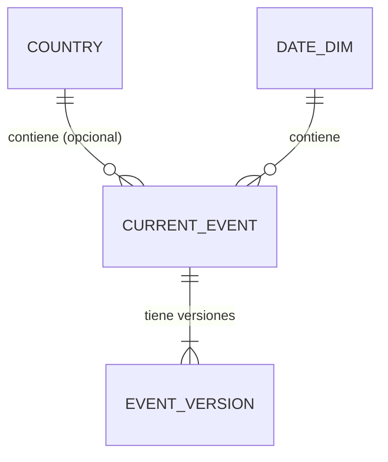

# Memoria — Observatorio de actividad sísmica

## 1. Objetivo, flujo de datos y alcance
## 2. Diccionario de datos

Fuente: feed `all_day.geojson` de USGS, según `docs/evidencias/f1/explore_usgs_salida.txt` (210 eventos). Los tiempos vienen en milisegundos Unix UTC y se convierten a UTC conservando el valor original. Los nulos no se rellenan con 0 y las magnitudes o profundidades negativas no se rechazan por serlo.

| Campo | Significado | Tipo / unidad | Si falta |
|---|---|---|---|
| `id` (raíz del Feature) | Identificador del evento (p. ej. `ci41570768`). Es único en la muestra (0 duplicados). | Texto | No faltó en la muestra (0 nulos). Un evento sin id es inválido y va a cuarentena. |
| `time` | Instante de origen del sismo. | Entero, milisegundos Unix (UTC) | No faltó (210/210). Un evento sin tiempo es inválido y va a cuarentena. |
| `updated` | Última actualización del evento. En la muestra nunca es anterior a `time`. | Entero, milisegundos Unix (UTC) | No faltó (210/210). Sirve para decidir qué versión es la más reciente. |
| `mag` | Magnitud del sismo. | Decimal, sin unidad (escala según `magType`) | No faltó en la muestra, pero el feed puede traerla nula: se guarda NULL, nunca 0. Hay un valor negativo (-0,06) y es válido. |
| `magType` | Tipo de escala de la magnitud. Valores vistos: `ml`, `md`, `mb`, `mww`, `mwr`. | Texto | No faltó (210/210); por confirmar su comportamiento si falta. |
| `place` | Descripción textual del lugar (p. ej. "3 km WSW of Anza, CA"). | Texto | No faltó (210/210). No se usa para obtener el país. |
| `type` | Tipo de evento. En la muestra todos son `earthquake`. | Texto | No faltó (210/210). Otros valores posibles: por confirmar. |
| `status` | Estado de revisión del evento. Valor visto: `automatic`; otros valores: por confirmar. | Texto | No faltó (210/210). |
| `coordinates[2]` (profundidad) | Profundidad del foco, tercera coordenada de la geometría. Hay 2 valores negativos (mínimo -0,18), válidos. | Decimal, kilómetros (unidad por confirmar con la documentación de USGS) | No faltó (0 nulos). Si falta se guarda NULL, nunca 0. |
## 3. Procedencia y registro de consultas
## 4. Calidad

### 4.1 Reglas de validación del consumidor

El consumidor valida cada mensaje de Kafka antes de tocar la base (`common/validation.py`, `common/validation_envelope.py`). Comprueba el tipo exacto (un `true` no es un número) y se detiene en el **primer** motivo que falla, en este orden. Los nulos se conservan como `NULL`: nunca se convierten en 0, y una magnitud o profundidad negativa es válida si está en rango.

| # | Motivo de cuarentena | Qué comprueba |
|---|---|---|
| 1 | `invalid_json` | Los bytes no son UTF-8 o JSON válido, o el valor es nulo (tombstone). |
| 2 | `invalid_envelope` | Faltan claves del sobre, `source` o `mode` fuera de los valores permitidos, `is_synthetic` no es booleano, o `ingested_at`/`replay_at` no son fechas UTC reales. |
| 3 | `mode_topic_mismatch` | El `mode` del mensaje no coincide con el del tema (por ejemplo, `replay` en `earthquakes.live`). |
| 4 | `replay_at_missing` | Un mensaje `replay` sin `replay_at`. |
| 5 | `missing_id` | Falta `id` del evento o está vacío. |
| 6 | `missing_time` | `properties.time` no es un entero. |
| 7 | `missing_updated` | `properties.updated` no es un entero. |
| 8 | `invalid_geometry` | La geometría no es un `Point` con al menos dos coordenadas. |
| 9 | `coordinates_out_of_range` | Longitud fuera de [-180, 180] o latitud fuera de [-90, 90] (o no finita). |
| 10 | `mag_out_of_range` | Magnitud fuera de [-10, 15]. |
| 11 | `depth_out_of_range` | Profundidad fuera de [-100, 1000] km. |
| 12 | `invalid_field_type` | `id`, `place`, `url`, `status` o `magType` no son texto; `sig` no es entero; `mag`, profundidad o coordenadas no son números. |
| 13 | `value_out_of_range` | `sig` fuera de `int32`, `time`/`updated` fuera del rango admitido por la base, o `id` de más de 512 caracteres. |
| 14 | `db_constraint_violation` | El evento no se puede guardar como `jsonb` (por ejemplo, anidamiento de más de 64 niveles). También se usa si la base rechaza el contenido con un error de integridad o de datos (SQLSTATE clase 23 o 22). |

### 4.2 Qué pasa con un mensaje inválido

- Va a la tabla `quarantine` con su motivo, el original, la referencia al mensaje (tema, partición y offset) y el SHA-256 de los bytes recibidos. No se escribe nada en las tablas de eventos.
- La clave de idempotencia es `(original_sha256, reason)`: el mismo original inválido por el mismo motivo no duplica fila.
- Una sola fila por mensaje, con el primer motivo según el orden anterior; el consumo no se detiene.
- `is_synthetic` se copia a la cuarentena solo si es un booleano exacto. Por eso las filas ilegibles (bytes no UTF-8 y tombstone) quedan en `false`.
- Los fallos de conexión con la base no son datos inválidos: se reintentan sin confirmar el offset y no producen cuarentena.

### 4.3 Reglas de escritura y verificación

- El offset se confirma solo después del commit en PostgreSQL; un corte entre ambos provoca una reentrega que se ignora (`ON CONFLICT (event_id, updated_ms) DO NOTHING`).
- Solo una versión con `updated` estrictamente mayor sustituye al estado actual; el historial conserva todas las versiones distintas.
- Evidencias: `docs/evidencias/consumidor-idempotente/` (pruebas 2, 3, 4, 6 y 8; 412 pruebas unitarias y 35 de integración).
## 5. Modelo conceptual, lógico y físico

> Borrador. Se completará con las mediciones de la sección 7 y con el resultado de la carga real cuando existan.

La base de datos se describe en tres niveles que representan **lo mismo**: el conceptual dice qué existe, el lógico lo organiza en tablas y claves, y el físico lo concreta en PostgreSQL 16. El DDL completo es [`sql/001_schema.sql`](../sql/001_schema.sql); su justificación, tabla por tabla, está en el contrato del esquema (`specs/001-contratos-y-modelo/contracts/db-schema.md`).

### 5.1 Modelo conceptual

El sistema guarda **terremotos**. Cada terremoto tiene un identificador de USGS y puede haber sido revisado varias veces: cada revisión es una **versión** y solo una es la **actual**. Un terremoto ocurre en un **día** y, si cae dentro de un polígono del catálogo, en un **país**; si no cae en ninguno queda «Sin país asignado» y no se deduce del texto del lugar. Aparte de los eventos, el sistema guarda lo que no se pudo aceptar (**cuarentena**), lo que se descartó a propósito por no ser un terremoto (**exclusión**) y el rastro de la **ingesta**: qué se publicó, qué consultas se hicieron al feed y qué respuestas originales se recibieron.

Hay dos conjuntos de eventos con la misma forma: el **modo en vivo** (que incluye el histórico de 2025) y la **reproducción**. Solo comparten el catálogo de países y las fechas; ningún evento pasa de uno a otro.

La cuarentena y las exclusiones se enlazan con los eventos solo por el identificador, sin clave foránea: un registro rechazado puede no corresponder a ningún evento válido.

### 5.2 Modelo lógico

Es un esquema de estrella pequeño, con el evento actual como tabla de hechos y el país y la fecha como dimensiones, más el historial de versiones y las tablas de calidad e ingesta.

| Tabla | Qué es una fila | Clave primaria | Relaciones |
|---|---|---|---|
| `current_event` | La versión actual de un terremoto | `event_id` | `country_id` → `country` (opcional); `date_id` → `date_dim` |
| `event_version` | Una versión observada de un evento | `(event_id, updated_ms)` | `event_id` → `current_event` |
| `country` | Un país del catálogo | `country_id` (código `ADM0_A3`) | — |
| `date_dim` | Un día UTC | `date_id` | — |
| `quarantine` | Un original rechazado y su motivo | `id`; único `(original_sha256, reason)` | — |
| `exclusion` | Un evento descartado de forma controlada | `id`; único `(event_id, updated_ms, kind)` | — |
| `ingest_state`, `ingest_run`, `raw_response` | Última versión publicada, una consulta al feed, una respuesta original | `event_id`, `id`, `id` | — |

Reglas que el modelo hace cumplir:

- **Versiones.** El estado actual solo se sustituye por una versión con `updated` estrictamente mayor. Toda versión recibida con un `updated` no visto se conserva en el historial, de modo que una revisión antigua que llega tarde no pisa a la posterior y un reenvío no duplica nada.
- **Tiempo.** Cada instante se guarda con su precisión completa (suficiente para agrupar por hora UTC) y también como el valor original de USGS en milisegundos.
- **Nulos.** Magnitud, profundidad y país admiten nulo, y el nulo nunca se sustituye por 0. Magnitudes y profundidades negativas son válidas.
- **Catálogo de países.** Cada evento se une con `country` por `country_id`, que se obtiene con un punto en polígono; así las agregaciones disponen del nombre en español, el continente y la subregión.

### 5.3 Modelo físico (PostgreSQL 16)

| Aspecto | Decisión |
|---|---|
| Esquemas | `public` (`country`, `date_dim`), `live` y `replay` (cuatro tablas cada uno, idénticas) y `ingest` (tres tablas, compartidas) |
| Instantes | `timestamptz` en UTC más un `bigint` con los milisegundos originales, con una restricción que obliga a que coincidan |
| Magnitud y profundidad | `numeric` que admite nulo, con límites de cordura (magnitud −10…15, profundidad −100…1000 km) que descartan `NaN` y valores imposibles sin rechazar negativos |
| Coordenadas | `double precision` con restricción de rango geográfico |
| Originales | `jsonb` para la versión original, la cuarentena y la respuesta cruda |
| Identificadores generados | `bigint GENERATED ALWAYS AS IDENTITY` |
| Datos sintéticos | `is_synthetic boolean NOT NULL DEFAULT false` en eventos, versiones, cuarentena y exclusiones |

Índices (cada uno responde a una consulta concreta; se conservarán solo si una medición con `EXPLAIN ANALYZE` los justifica, sección 7):

| Índice | Consulta que lo motiva |
|---|---|
| `ix_current_event_time (event_time DESC, event_id DESC)` | Listado de eventos por rango de tiempo con paginación estable |
| `ix_current_event_country_time (country_id, event_time DESC)` | Eventos de un país en un rango de tiempo |
| `ix_current_event_mag (mag)` | Filtro por magnitud mínima (candidato a medir) |
| `ix_quarantine_event_id` | Búsqueda de rechazos por evento |
| `ix_ingest_run_last_ok` (parcial) | Última consulta correcta al feed |
| `ix_raw_response_fetched_at`, `ix_raw_response_sha256` | Respuestas por fecha y detección de respuestas repetidas |

El aislamiento de la reproducción es estructural: `live` y `replay` son esquemas distintos con las mismas tablas, y los datos de reproducción nunca se escriben en `live`.

### 5.4 Equivalencia con la estructura orientativa del enunciado

| Enunciado | Proyecto | Qué representa una fila |
|---|---|---|
| `evento_actual` (hecho) | `current_event` | La versión más reciente de un terremoto |
| `evento_version` | `event_version` | Una versión observada, única por `(event_id, updated)` |
| `pais` | `country` | Una entidad del catálogo |
| `fecha` (`fecha_id`) | `date_dim` (`date_id`) | Un día UTC |
| `cuarentena` | `quarantine` | Un registro rechazado con su motivo |
| Estado de ingesta y calidad | `ingest_state`, `ingest_run`, `raw_response` y `exclusion` | Última versión publicada, consultas, respuestas originales y exclusiones |

Los identificadores del proyecto están en inglés; el enunciado usa nombres en español como estructura orientativa, no obligatoria.

### 5.5 Pruebas del esquema

El DDL se aplicó dos veces seguidas en PostgreSQL 16 sin errores, `live` y `replay` resultaron idénticos y un script de 18 pruebas comprobó las restricciones, las reglas de versiones, la cuarentena, el aislamiento y las consultas principales. Las salidas están en `docs/evidencias/contratos-y-modelo/`.

## 6. Análisis y conclusiones
## 7. Complejidad, mediciones y costes

Cifras copiadas de [`docs/evidencias/mediciones/`](evidencias/mediciones/README.md) (cada una con su id de medición en `resultados.json`). Los datos de `bench` son **SINTÉTICOS** (esquema temporal `bench`, semilla 20251113, eliminado al terminar, sin ninguna fila fuera de él: `aislamiento.md`); los datos reales (REAL) solo se leyeron. Tiempos en ms (mediana de hasta 15 repeticiones), medidos en la VM de Docker Desktop (Windows, WSL2) con 24 CPU y 15,17 GiB (`equipo.md`). Procedimiento: [`procedimiento.md`](evidencias/mediciones/procedimiento.md). Tamaños: 1.000, 10.000 y 100.000 filas; 102 mediciones.

### 7.1 Operaciones, teoría y observado (K1, K2, K3)

| Operación | Estrategias | Coste medio / peor caso (teoría) | Observado a 100.000 filas (SINTÉTICO) |
|---|---|---|---|
| a. Búsqueda de versiones por id | lista, `dict`, PostgreSQL sin índice y con índice | lista O(n) / O(n); `dict` O(1) / O(n) teórico; `Seq Scan` O(n); B-tree O(log n) | id ausente: lista 2,058552 ms; `dict` 0,000062 ms; sin índice 4,799034 ms; con índice 0,146670 ms. Construir el `dict`: 6,512775 ms y 5.632,09 KiB de pico |
| b. Integración geográfica (punto en 177 polígonos) | bucle ingenuo y `STRtree` | lineal en puntos; el árbol reduce los polígonos candidatos | puntos mezclados: bucle 1.919,619815 ms; `STRtree` 610,28769 ms; 0 de 100.000 con resultado distinto entre métodos |
| c. Agregación por ventanas (Q2, Q3, Q4 de `db-schema.md` §4) | sin índice y con índice | `Seq Scan` O(n) / O(n); con índice depende de las filas devueltas | Q2 un mes: 5,358898 → 0,182825 ms; Q4 un día: 3,526351 → 0,375212 ms; Q4 toda la tabla: 17,246617 vs 17,316232 ms (el índice no ayuda) |

En el caso **medio** el id está en el medio, los puntos son mezclados y la ventana es selectiva; en el **peor**, el id no existe, los puntos caen en el océano (recorren los 177 polígonos) y la ventana abarca casi toda la tabla. Comparación completa de teoría frente a observado: [`teoria_vs_observado.md`](evidencias/mediciones/teoria_vs_observado.md); tablas de las 102 mediciones: [`tablas.md`](evidencias/mediciones/tablas.md).

### 7.2 Índices justificados con medición (E6)

| Índice | Veredicto (SINTÉTICO) |
|---|---|
| `ix_current_event_country_time` | Justificado en los 6 casos de Q2 |
| `ix_current_event_time` | Justificado para un día a 10.000 y 100.000 filas; no concluyente a 1.000; no justificado con la ventana de toda la tabla |
| `ix_current_event_mag` | Depende del umbral y del tamaño: con `mag >= 4` (selectividad 0,9458) solo mejora de 5,956245 a 4,00266 ms a 100.000 filas; en la base real tiene 9 lecturas y 560 KiB. No queda demostrado conservarlo ni descartarlo |

Son propuestas: no se ha modificado el DDL. Detalle en [`indices.md`](evidencias/mediciones/indices.md).

### 7.3 Qué pasaría con 100 millones de registros (K5)

Razonamiento SUPUESTO a partir de lo medido hasta 100.000 filas; no se midió 10^8 ([`escalado.md`](evidencias/mediciones/escalado.md)):

- **Almacenamiento:** 363,2 B por fila de `bench` con índices darían 33,8 GiB; `live.event_version` (1.090,3 B por fila real) daría 101,5 GiB.
- **CPU:** la integración geográfica con `STRtree` serían 10,2 min (bucle ingenuo, 32 min). Sin índice, buscar por id costaría del orden de 4.799 ms frente a 0,147 ms con índice.
- **Escrituras:** una transacción por mensaje serían 4,0 h solo de ida y vuelta; con lotes de 1.000, 14,5 s.
- **Paralelismo:** con 12 consumidores la integración geográfica bajaría a 51 s; hacen falta al menos tantas particiones de Kafka como consumidores (cambio de contrato, decisión del alumno).
- **Particionado por `event_time`:** una ventana de un día leería unas 54 veces menos filas; obliga a cambiar la clave primaria.

### 7.4 Costes (K6)

Cada cifra lleva su origen (MEDIDO, SUPUESTO o ESTIMADO) y su naturaleza (en efectivo o imputada: el equipo y el tiempo propio no desembolsan dinero, pero tienen coste). Mes de 30 días, 0,169 EUR/kWh, 100 W. Fórmulas y entradas: [`costes.md`](evidencias/mediciones/costes.md).

| Concepto | Naturaleza | A: 12 h/día (EUR/mes) | B: 24/7 (EUR/mes) |
|---|---|---|---|
| Hardware (1.100 EUR / 48 meses, fracción de uso 1) | imputado | 22,92 | 22,92 |
| Electricidad | efectivo | 6,08 | 12,17 |
| Almacenamiento (0,0439215 GiB MEDIDO) | imputado; efectivo 0 | 0,0006 | 0,0006 |
| Transferencia (109.996 B por petición MEDIDO; 5 a 10 visitas/mes SUPUESTO) | efectivo 0 | 0 | 0 |
| Mantenimiento (2 h/mes x 15 EUR/h) | imputado | 30,00 | 30,00 |
| Dominio (22 EUR/año) | efectivo | 1,83 | 1,83 |
| **Total imputado** | | **≈ 60,8** | **≈ 66,9** |
| **Total en efectivo** | | **≈ 7,9** | **≈ 14,0** |

Desarrollo: 1.080 EUR una sola vez (72 h x 15 EUR/h; rango 810 a 1.350 EUR). Una cuota gratuita (Netlify, Cloudflare Tunnel) no equivale a coste cero: superar su límite puede generar un cobro. No se calcula ROI ni se atribuye un beneficio económico al observatorio.

### 7.5 Propuestas de escalado ligadas a hallazgos (K7)

Las 8 propuestas, cada una con su problema medido, la mejora y la medición que la confirmaría, están en [`escalado.md`](evidencias/mediciones/escalado.md). Entre ellas: mantener la clave primaria para toda búsqueda por id (32,7 veces más rápida que sin índice); no cargar todos los ids en un `dict` en el consumidor; repartir la integración geográfica entre consumidores; escribir por lotes; comprimir la respuesta de `/api/eventos` (el 97,4 % de los bytes de una visita) y definir una retención para `ingest.raw_response` (el 18,8 % de la base). Las que tocan contrato o DDL son decisión del alumno.

### 7.6 Limitaciones de la medición

- Medido en la VM de Docker Desktop (WSL2), no en el anfitrión directamente; el stack siguió en marcha durante las mediciones. Los tiempos absolutos no se trasladan a otro equipo: sirve la comparación entre estrategias dentro de la misma corrida.
- La memoria con `tracemalloc` solo cuenta lo que reserva Python y solo se midió al construir el `dict` y en la integración geográfica.
- Con 1.000 filas domina la ida y vuelta al servidor (ruido): ahí el `Seq Scan` no se distingue del índice. Con tres tamaños solo se puede decir que la tendencia es compatible con la teoría.
- Valor atípico sin explicar: `server_ms` de `search.pg_seq.100000.first` (7,057 ms).
- Costes: casi todo es SUPUESTO; el consumo eléctrico (100 W) no se midió, y el límite de la cuota gratuita de Netlify no está verificado.
- Aún no se ha repetido el procedimiento desde un clon limpio.

### Mejoras propuestas

Añadir una capa de mares y océanos (polígonos de una segunda fuente por determinar, con licencia por comprobar y declarada como material reutilizado) para clasificar los eventos que hoy quedan en "Sin país asignado". Se justificará con el porcentaje real de eventos sin país cuando el histórico esté cargado (cifra pendiente).
## 8. Evidencias de las 11 pruebas
## 9. Reproducción histórica
## 10. Limitaciones

Los eventos en el mar quedan como "Sin país asignado"; el campo `place` de USGS se muestra como descripción, pero no se usa para asignar país.