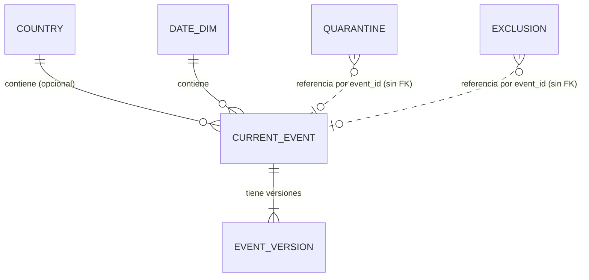

# Modelo de datos — borrador conceptual, lógico y físico

Borrador para `docs/memoria.md` §5 (E1). Describe **la misma base de datos** en tres niveles. Las definiciones exactas viven en `contracts/db-schema.md` y `sql/001_schema.sql`; este documento no las duplica en detalle: las explica. En tasks se añadirá una tarea para **reescribirlo** en `docs/memoria.md` §5 (no se copia `specs/` a `docs/`, constitución §18).

## 1. Nivel conceptual

Qué cosas existen y cómo se relacionan, sin tipos ni tablas.

| Entidad | Qué es |
|---|---|
| **Evento sísmico** | Un terremoto identificado por el `id` de USGS. Tiene una versión actual. |
| **Versión de evento** | Cada revisión observada de un evento, distinguida por su `updated`. |
| **País** | Entidad del catálogo geográfico (`ADM0_A3`). |
| **Fecha** | Día UTC al que pertenece el evento. |
| **Registro en cuarentena** | Original inválido rechazado, con motivo. |
| **Exclusión** | Evento descartado de forma controlada (tipo distinto de terremoto). |
| **Estado de ingesta** | Qué se publicó, qué consultas se hicieron al feed y qué respuestas originales se guardaron. |

Relaciones:

- Un **evento** tiene **una o más versiones**; exactamente una es la **actual**.
- Un **evento** ocurre en **un día** y **puede** estar en **un país** (o en ninguno: «Sin país asignado»).
- Un **país** contiene **cero o más eventos**; un **día** contiene **cero o más eventos**.
- La **cuarentena**, las **exclusiones** y el **estado de ingesta** no se relacionan por clave con los eventos: referencian el original o el identificador.
- Existen **dos universos** de eventos con la misma forma: **en vivo** (incluye el histórico 2025) y **reproducción**. Comparten solo el catálogo de países y las fechas.

## 2. Nivel lógico

Tablas, atributos, claves y relaciones, independientes del motor.

**Hecho**: `current_event` (grano: un evento = una fila actual).
**Dimensiones**: `country`, `date_dim`.
**Historial**: `event_version` (grano: un evento y un valor de `updated`).
**Calidad**: `quarantine`, `exclusion`. **Ingesta**: `ingest_state`, `ingest_run`, `raw_response`.

| Tabla | Clave primaria | Claves foráneas | Atributos principales |
|---|---|---|---|
| `country` | `country_id` | — | `name_es`, `admin`, `continent`, `subregion` |
| `date_dim` | `date_id` | — | `year`, `month`, `day`, `dow` |
| `current_event` | `event_id` | `country_id` → `country` (opcional); `date_id` → `date_dim` | instante del evento (+ original en ms), `updated` (+ original en ms), `mag`, `mag_type`, `depth_km`, `lon`, `lat`, `place`, `status`, `url`, `sig`, `source`, `is_synthetic`, `ingested_at`, `replay_at` |
| `event_version` | `(event_id, updated_ms)` | `event_id` → `current_event` | instante y `updated`, `mag`, `depth_km`, `original`, `source`, `is_synthetic`, `received_at`, referencia al mensaje Kafka |
| `quarantine` | `id` (único también `(original_sha256, reason)`) | — | `event_id`, `reason`, `original` o `raw_text`, referencia al mensaje Kafka |
| `exclusion` | `id` (único también `(event_id, updated_ms, kind)`) | — | `kind`, `reason`, `observed_type`, `fetched_at` |
| `ingest_state` | `event_id` | — | `last_updated_ms`, `published_at` |
| `ingest_run` | `id` | — | `run_at`, `url`, `status`, `latency_ms`, `event_count`, `sha256`, `error` |
| `raw_response` | `id` | — | `fetched_at`, `sha256`, `body` |

Reglas lógicas:

- **Versiones (C4):** `current_event` solo se sustituye con un `updated` estrictamente mayor; `event_version` conserva toda versión recibida con un `updated` no visto.
- **Tiempo (E7):** el instante completo del evento se guarda como `timestamptz` con precisión de microsegundo, que guarda el valor de USGS (milisegundo) junto con el original en ms.
- **Nulos:** magnitud, profundidad y país admiten nulo; el nulo no equivale a 0.
- **Integración con el catálogo (E4):** cada evento se une con `country` por `country_id` (obtenido por punto en polígono), lo que aporta nombre en español, continente y subregión a las agregaciones.
- **Esquemas `live` y `replay`:** mismas tablas lógicas; ningún dato cruza de uno a otro.

## 3. Nivel físico (PostgreSQL)

Tipos, esquemas e índices concretos. DDL completo en [`sql/001_schema.sql`](../../sql/001_schema.sql).

| Aspecto | Decisión |
|---|---|
| Esquemas | `public` (`country`, `date_dim`), `live`, `replay` (4 tablas cada uno), `ingest` (3 tablas) |
| Instantes | `timestamptz` (UTC) + `bigint` con los milisegundos Unix originales; `CHECK` de coherencia entre ambos |
| Magnitud y profundidad | `numeric` nulo, con `CHECK` de rango de cordura que admite negativos |
| Coordenadas | `double precision` `lon`, `lat` con `CHECK` de rango |
| Original | `jsonb` (`event_version.original`, `quarantine.original`, `raw_response.body`) |
| Identificadores generados | `bigint GENERATED ALWAYS AS IDENTITY` |
| Marca de sintéticos | `is_synthetic boolean NOT NULL DEFAULT false` |
| Índices | `ix_current_event_time (event_time DESC, event_id DESC)`, `ix_current_event_country_time (country_id, event_time DESC)`, `ix_current_event_mag (mag)` (candidato), `ix_quarantine_event_id`, `ix_ingest_run_last_ok` (parcial), `ix_raw_response_fetched_at`, `ix_raw_response_sha256`; más PK y únicas. Cada uno ligado a una consulta (Q1–Q13) en `db-schema.md` §4 |

Los índices se mantienen solo si una medición (`EXPLAIN ANALYZE`, feature `mediciones-costes`) los justifica (FAQ 20, E6).

## 4. Equivalencia de nombres con el enunciado (E3)

| Enunciado (ENUNCIADO §7 / FAQ 20) | Proyecto (inglés) | Qué representa una fila |
|---|---|---|
| `evento_actual` (hecho) | `current_event` | La versión más reciente de un terremoto |
| `evento_version` | `event_version` | Una versión observada, única por `(event_id, updated)` |
| `pais` | `country` | Una entidad del catálogo |
| `fecha` (`fecha_id`) | `date_dim` (`date_id`) | Un día UTC |
| `cuarentena` | `quarantine` | Un registro rechazado con su motivo |
| Estado de ingesta y calidad | `ingest_state`, `ingest_run`, `raw_response` (+ `exclusion`) | Última versión publicada, consultas, respuestas originales y exclusiones |

## 5. Del conceptual al físico: trazabilidad

| Concepto | Lógico | Físico |
|---|---|---|
| Evento actual | `current_event` | `live.current_event`, `replay.current_event` |
| Versión | `event_version` | `live.event_version`, `replay.event_version` |
| País | `country` | `public.country` (clave = `ADM0_A3`) |
| Fecha | `date_dim` | `public.date_dim` |
| Cuarentena | `quarantine` | `live.quarantine`, `replay.quarantine` |
| Exclusión | `exclusion` | `live.exclusion`, `replay.exclusion` |
| Estado de ingesta | `ingest_*` | `ingest.ingest_state`, `ingest.ingest_run`, `ingest.raw_response` |

## 6. Cobertura de requisitos

| Requisito | Dónde |
|---|---|
| E1 | Este documento (tres niveles) |
| E2 | `contracts/db-schema.md` §3 y §4 (grano, claves, relaciones, índices por consulta) |
| E3 | §4 de este documento y `db-schema.md` §6 |
| E4 | §2, «Integración con el catálogo» |
| E5 | `sql/001_schema.sql` |
| E7 | §2 y §3 (`timestamptz` + ms originales) |
| C4 | `contracts/kafka-message.md` §5 y `db-schema.md` §5 |
